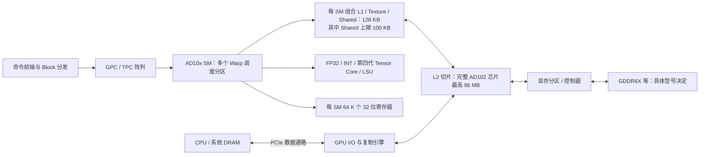

---
{"dg-publish":true,"permalink":"/CS工程体系/GPU编程/Ada-AD10x-硬件结构/","dg-note-properties":{}}
---

# Ada：AD10x / RTX 40 系列硬件结构

定位：RTX 40 系列的 Ada GPU 通常为 Compute Capability 8.9；下图以 AD102 这类芯片解释 CUDA 计算路径。返回 [[CS工程体系/GPU编程/GPU硬件结构-硬件逻辑\|GPU硬件结构-硬件逻辑]]。

图中“组合 L1 / Shared → L2”只表示全局内存请求的 Cache 出口；线程访问 Shared 不会自动走到 L2。

## 芯片路径



Ada 的一个核心变化是片上 L2 显著增加。官方调优指南给完整 AD102 芯片 98,304 KB（96 MiB）的 L2；RTX 4090 等具体产品可只启用部分缓存。较大的 L2 可能降低重复读取进入显存的比例，但它不能修复不合并访存、低数据复用或过大的工作集。

## 一个 SM 的资源边界

| 指标 | Ada / 8.9 |
| --- | ---: |
| 驻留 Warp 上限 | 48 |
| 32 位寄存器数 | 64 K |
| 驻留 Block 上限 | 24 |
| 共享内存容量上限 | 100 KB |
| 单 Block 可用共享内存上限 | 99 KB |
| 组合 L1 / Texture / Shared 容量 | 128 KB |

Ada 相比 8.0 架构的 SM，有更高的 FP32 理论每周期吞吐量；相比 8.6，Warp 上限仍为 48，但每 SM Block 上限从 16 变为 24。Block 很小时，这个差别可能有意义；Block 很大或寄存器占满时，它也可能完全不起作用。

## 两条数据路径

```text
普通全局内存 load：
线程计算地址 → Warp 内请求合并 → L1 / L2 → 未命中进入 GDDR → 返回寄存器

显式 tile 复用：
线程加载全局内存 → 写入 Shared → Block 内同步
→ 多次从 Shared 读取 → 算术 / Tensor Core 指令 → 写回全局内存
```

大 L2 影响第一条路径的重复访存；共享内存改变第二条路径中的数据复用。它们不是互相替代：共享内存需要程序员决定 tile，L2 由硬件缓存策略管理。

## 面试追问

**“RTX 4090 的 L2 大，为什么矩阵乘法还需要 Shared？”** L2 是跨 SM 的自动缓存，不能保证某个 Block 的 tile 在期望时刻以期望布局可用；Shared 让 Block 显式组织 tile、复用并配合同步和矩阵指令。代价是占用有限的 Shared 容量。

**“把 A100 kernel 原封不动迁到 Ada 会怎样？”** 若使用超过 99 KB 的单 Block 共享内存，配置不合法；即使合法，48 Warp/SM 与 L2/GDDR 路径不同，应重新计算资源占用和测量性能。

## 来源

- [NVIDIA Ada Tuning Guide：Occupancy、L2、Unified Shared Memory/L1](https://docs.nvidia.com/cuda/ada-tuning-guide/index.html)
