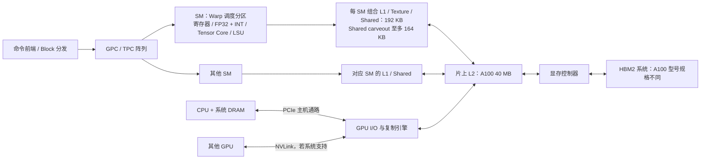
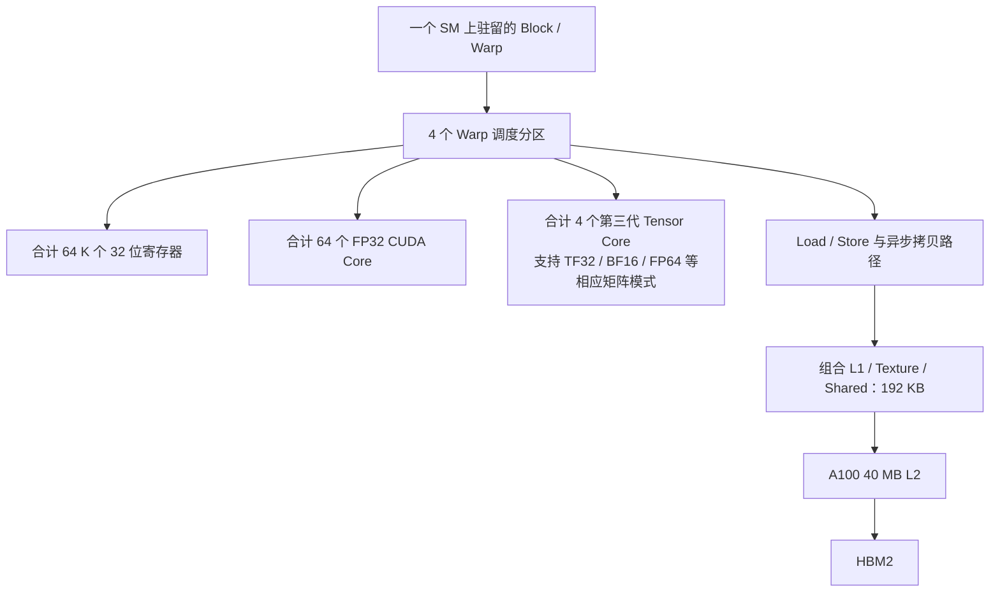
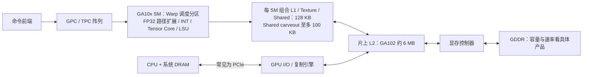
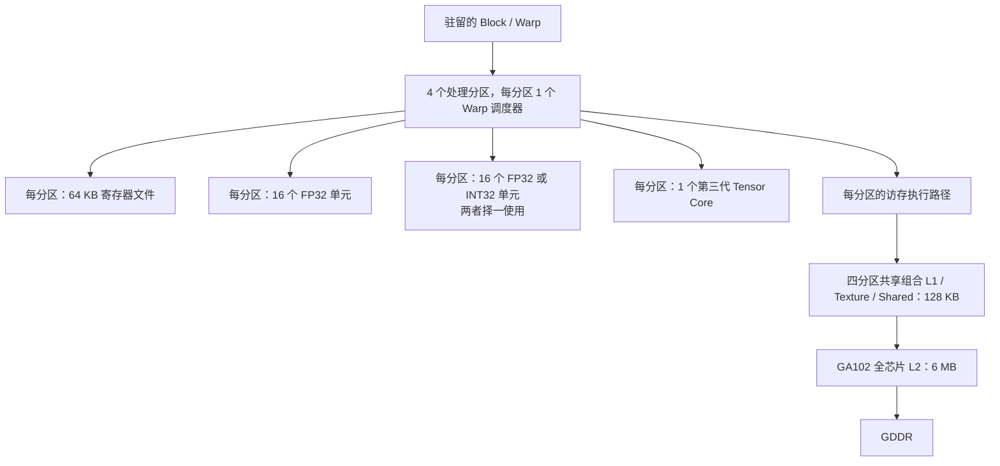

---
{"dg-publish":true,"permalink":"/CS工程体系/GPU编程/Ampere-A100与GA10x-硬件结构/","dg-note-properties":{}}
---

# Ampere：A100（GA100）与 RTX 30 系列（GA10x）硬件结构

定位：A100 是 Compute Capability 8.0；RTX 30 系列常见 GA10x 是 8.6。两者共享 Ampere 世代技术，但不能用同一个 SM 资源表或显存图解释性能。返回 [[CS工程体系/GPU编程/GPU硬件结构-硬件逻辑\|GPU硬件结构-硬件逻辑]]。

以下图中“组合 L1 / Shared → L2”只表示全局内存请求的 Cache 出口；线程访问 Shared 不会因此自动走到 L2。

## A100 / GA100：数据中心路径

一个 Block 占用单个 SM 的寄存器和共享内存；多个 Block 能否同驻留，由资源上限共同决定。A100 有第三代 Tensor Core；Ampere 引入从全局内存到共享内存的异步拷贝能力和硬件支持的 arrive/wait barrier。它适合把“读取下一个 tile”和“计算当前 tile”做成流水，但需要显式管理完成与可见性。

GA100 **完整芯片设计**为 8 GPC × 每 GPC 8 TPC × 每 TPC 2 SM = 128 SM；白皮书所述 A100 **产品配置**启用 108 SM、5 组 HBM2 stack 和 10 个 512 位显存控制器。这里正好说明为什么不能把“芯片设计图”中的 128 SM 当作手里 A100 的可用 SM 数。

### A100 的 SM 再放大一层

图中的“4 个 Warp 调度分区”表示 SM 内四个指令发射来源；64 个 FP32 Core、4 个 Tensor Core 是 A100 SM 的合计值。Tensor Core 吞吐与精度模式相关，不能用“Tensor Core 个数”直接比较矩阵性能。

## GA10x / RTX 30：消费级路径

GA10x 的 FP32 理论每周期吞吐量相对 A100 的 8.0 SM 更高，但这不表示所有 CUDA 工作负载都快两倍：内存、INT 指令混合、资源占用和芯片总 SM 数都会改变结果。图中的 6 MB 指完整 GA102 芯片层级的 L2 比较值；具体产品可能关闭部分单元。

完整 GA102 芯片设计为 7 GPC × 每 GPC 6 TPC × 每 TPC 2 SM = 84 SM；显存系统有 12 个 32 位控制器，每个配 512 KB L2 切片，合计 6 MB。RTX 3090 等产品可能只启用完整芯片的一部分，因此产品规格仍需单独查。

### GA10x 的 SM：为什么 FP32 理论吞吐翻倍

四个分区合计最多 128 个 FP32 运算/周期，或者在混合负载中最多 64 个 FP32 加 64 个 INT32 运算/周期（白皮书的峰值模型）。第二条数据路径同一时刻在 FP32 和 INT32 之间选择，不能把两个峰值简单相加。每 SM 合计仍是 64 K 个 32 位寄存器，即 256 KB 寄存器文件；与前面的 Occupancy 表一致。

## 资源差异：先看会改变 kernel 配置的量

| 每 SM 的公开上限 | A100 / 8.0 | GA10x / 8.6 |
| --- | ---: | ---: |
| 驻留 Warp 上限 | 64 | 48 |
| 32 位寄存器数 | 64 K | 64 K |
| 驻留 Block 上限 | 32 | 16 |
| 共享内存容量上限 | 164 KB | 100 KB |
| 单 Block 可用共享内存上限 | 163 KB | 99 KB |
| 组合 L1 / Texture / Shared 容量 | 192 KB | 128 KB |

共享内存容量不是所有 Block 都能无条件用到的容量：静态分配通常仍受 48 KB 兼容上限约束，更大的动态共享内存需要 opt-in；CUDA 还为每个 Block 保留部分空间。寄存器也按线程和分配粒度消耗，因此表中理论上限不是实际 occupancy。

## 用一条路径回答面试追问

**“A100 上每 Block 用 120 KB 共享内存的 kernel，直接搬到 RTX 3090 会怎样？”**

1. A100 的单 Block 上限 163 KB，资源配置可能合法，但每 SM 大致只能放一个这样的 Block（还要看寄存器与线程上限）。
2. 8.6 的单 Block 上限 99 KB，同样配置超出上限，不能照搬；需要缩 tile 或改算法。
3. 即使缩小到合法，GA10x 的 Warp 上限、Block 上限和显存系统也不同，必须重新测量。

**“第三代 Tensor Core 会自动加速 `float c=a+b` 吗？”** 不会。普通标量 FP32 加法走标量/向量 FP32 执行路径；Tensor Core 需要相应矩阵指令与受支持的数据格式。

## 来源

- [NVIDIA Ampere Tuning Guide：Occupancy、Memory System、Tensor Core](https://docs.nvidia.com/cuda/ampere-tuning-guide/index.html)
- [NVIDIA A100 Architecture Whitepaper](https://images.nvidia.com/aem-dam/en-zz/Solutions/data-center/nvidia-ampere-architecture-whitepaper.pdf)
- [NVIDIA GA102 Architecture Whitepaper](https://images.nvidia.com/aem-dam/en-zz/Solutions/geforce/ampere/pdf/NVIDIA-ampere-GA102-GPU-Architecture-Whitepaper-V1.pdf)
