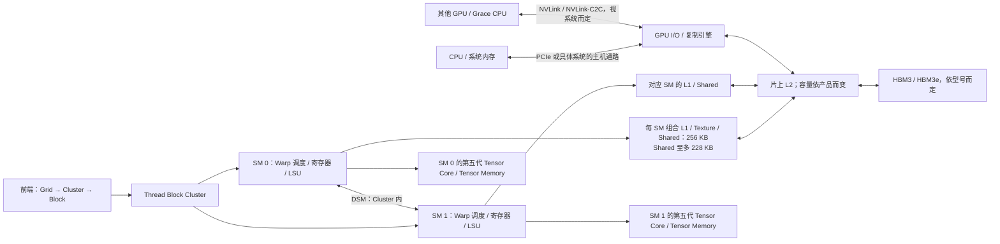
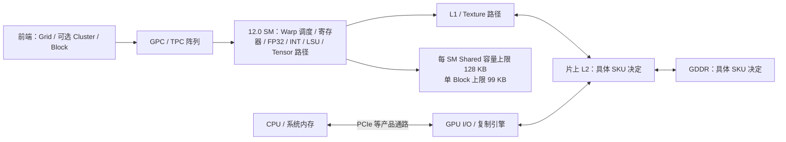

---
{"dg-publish":true,"permalink":"/CS工程体系/GPU编程/Blackwell-B200与RTX50-硬件结构/","dg-note-properties":{}}
---

# Blackwell：B200 与 RTX 50 系列硬件结构

定位：B200 是数据中心 Blackwell（Compute Capability 10.0）；RTX 50 系列是消费级 Blackwell（12.0）。共享“Blackwell”名字不表示 SM、共享内存容量、显存和矩阵指令路径相同。返回 [[CS工程体系/GPU编程/GPU硬件结构-硬件逻辑\|GPU硬件结构-硬件逻辑]]。

图中“组合 L1 / Shared → L2”只表示全局内存请求的 Cache 出口；本地 Shared 访问不会自动进入 L2。

## B200 / 10.0：数据中心路径

B200 可继续使用 Cluster 与 DSM；官方指南给 10.0 架构 64 Warp/SM、228 KB Shared/SM、单 Block 至多 227 KB Shared。Blackwell 数据中心 Tensor Core 的 `tcgen05` 路径引入专用 Tensor Memory（TMEM），用于矩阵运算中间状态；**TMEM 不等于普通寄存器、Shared 或 L2**。它需要专门的分配、访存和同步指令，不是普通 C++ 数组自动使用的存储层。

官方调优指南称 GB200 的 L2 为 126 MB；这不是“所有 B200 与 RTX 50 产品的统一 L2 容量”。图中故意把 L2 只标为产品相关。

## RTX 50 / 12.0：消费级路径

12.0 的每 SM Shared 总容量是 128 KB，但单 Block 上限是 99 KB；不要把总容量减 1 KB 当成单 Block 容量。12.0 可使用 Thread Block Cluster，但不应把 10.0 的 TMEM / `tcgen05` 编程路径、HBM 或数据中心互连直接搬到 RTX 50。

## 同代差异表

| 每 SM 的公开上限 | B200 / 10.0 | RTX 50 / 12.0 |
| --- | ---: | ---: |
| 驻留 Warp 上限 | 64 | 48 |
| 32 位寄存器数 | 64 K | 64 K |
| 驻留 Block 上限 | 32 | 32 |
| 共享内存容量上限 | 228 KB | 128 KB |
| 单 Block 可用共享内存上限 | 227 KB | 99 KB |
| 组合 L1 / Texture / Shared 容量 | 256 KB | 不用 B200 的数值代替，查具体设备 |
| 常见设备 DRAM | HBM 系列 | GDDR 系列 |

## 面试追问

**“某 kernel 每 Block 用 160 KB Shared，B200 和 RTX 50 都叫 Blackwell，能通用吗？”** 10.0 的单 Block 上限是 227 KB，满足共享内存这一项；12.0 的上限是 99 KB，不能以同样配置 launch。还需检查 opt-in、线程和寄存器资源。

**“第五代 Tensor Core 的 TMEM 是新的全局内存吗？”** 不是。PTX ISA 把 Tensor Memory 定义为第五代 Tensor Core 专用的片上存储，按 CTA 管理。普通线程全局内存访问仍走正常的寄存器、Cache 和显存路径。

**“能把一个 B200 的 Cluster 从 8 Block 改成 16 Block 吗？”** 官方指南说 B200 支持 opt-in 的非可移植 16 Block Cluster，但可能降低 GPU 上可同时活跃的 Block 数；不能默认其他 Blackwell 芯片都支持同样配置。

## 来源

- [NVIDIA Blackwell Tuning Guide：Occupancy、Cluster、Memory System](https://docs.nvidia.com/cuda/blackwell-tuning-guide/index.html)
- [NVIDIA PTX ISA：Tensor Memory 与 tcgen05](https://docs.nvidia.com/cuda/parallel-thread-execution/index.html)
