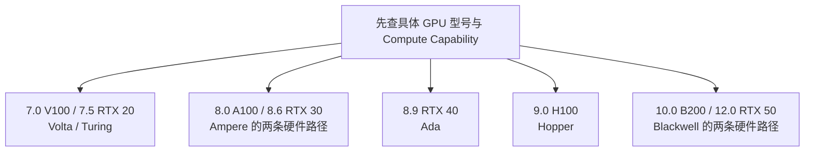

---
{"dg-publish":true,"permalink":"/CS工程体系/GPU编程/CUDA学习主线-硬件逻辑/","dg-note-properties":{}}
---

# CUDA 学习主线-硬件逻辑

> **先建立 GPU 的执行和数据路径，再观察 CUDA 如何使用这些硬件机制。**

这条主线从硬件逻辑观察 GPU 和 CUDA。

它和 [[CS工程体系/GPU编程/CUDA学习主线-软件逻辑\|CUDA学习主线-软件逻辑]] 使用同一组主题，但侧重点不同：

- 硬件逻辑问：GPU 怎样执行线程、访问数据和完成同步？
- 软件逻辑问：CUDA 怎样组织线程、分配内存、提交 kernel 和处理结果？
- 业务场景问：这些机制怎样影响吞吐、延迟和可扩展性？

图是跨 NVIDIA GPU 架构的入口。具体芯片的 SM、Cache、互连和内存类型见 [[CS工程体系/GPU编程/GPU硬件结构-硬件逻辑\|GPU硬件结构-硬件逻辑]] 下的 Volta、Turing、Ampere、Ada、Hopper 和 Blackwell 独立架构图。不要把入口图当作任一代芯片的精确拓扑。

## 按设备选择硬件图



- [[CS工程体系/GPU编程/Volta与Turing-硬件结构\|Volta与Turing-硬件结构]]
- [[CS工程体系/GPU编程/Ampere-A100与GA10x-硬件结构\|Ampere-A100与GA10x-硬件结构]]
- [[CS工程体系/GPU编程/Ada-AD10x-硬件结构\|Ada-AD10x-硬件结构]]
- [[CS工程体系/GPU编程/Hopper-H100-硬件结构\|Hopper-H100-硬件结构]]
- [[CS工程体系/GPU编程/Blackwell-B200与RTX50-硬件结构\|Blackwell-B200与RTX50-硬件结构]]

每篇分别画整颗 GPU 的路径和该代关键 SM 资源。跨代术语只在 [[CS工程体系/GPU编程/GPU硬件结构-硬件逻辑\|GPU硬件结构-硬件逻辑]] 定位，不用一张图替代所有芯片。

## 推荐顺序

| 顺序 | 主题 | 需要回答的问题 |
| --- | --- | --- |
| 1 | [[CS工程体系/GPU编程/GPU硬件结构-硬件逻辑\|GPU硬件结构-硬件逻辑]] | GPU 与 CPU 怎样连接？目标芯片的 SM、Cache、显存与专用单元如何组成路径？ |
| 2 | [[CS工程体系/GPU编程/CUDA线程层次与执行模型-硬件逻辑\|CUDA线程层次与执行模型-硬件逻辑]] | Grid、Block、Warp 怎样映射到 SM，warp 怎样发射指令？ |
| 3 | [[CS工程体系/GPU编程/GPU内存层次-硬件逻辑\|GPU内存层次-硬件逻辑]] | 寄存器、共享内存、L1/L2 和显存的容量与延迟差异从哪里来？ |
| 4 | CUDA 数据传输（待写） | Host、Device、DMA 和复制引擎怎样完成数据移动？ |
| 5 | CUDA 同步与原子操作（待写） | warp、block、device 范围的同步和原子操作依赖什么硬件？ |
| 6 | CUDA 资源分配与占用率（待写） | 寄存器、共享内存和 SM 调度资源怎样限制并发 Block？ |
| 7 | CUDA 流与异步执行（待写） | 多个 Stream 怎样进入硬件队列并与复制引擎重叠？ |
| 8 | CUDA 性能分析（待写） | 如何从访存、发射、占用率和执行单元利用率定位瓶颈？ |

## 每个硬件专题的固定格式

```text
一张目标架构的硬件结构图
+ 一条指令路径或数据路径
+ 一组会限制性能的资源数值
+ 一个能承受追问的 CUDA 场景
```

先看主图，再沿路径阅读，最后用场景验证路径是否闭合。

