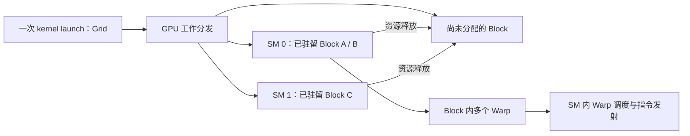

---
{"dg-publish":true,"permalink":"/CS工程体系/GPU编程/CUDA线程层次与执行模型-硬件逻辑/","dg-note-properties":{}}
---

# 主题二：CUDA 线程层次与执行模型-硬件逻辑

本篇沿着“一次 launch → 一个 Block 驻留 → 一个 Warp 发射 → 一次访存”追踪硬件。软件侧见 [[CS工程体系/GPU编程/CUDA线程层次与执行模型-软件逻辑\|CUDA线程层次与执行模型-软件逻辑]]；各代资源上限见 [[CS工程体系/GPU编程/GPU硬件结构-硬件逻辑\|GPU硬件结构-硬件逻辑]]。

## 1. Grid 的 Block 怎样进入 SM



Block 是资源分配与协作的基本单位。普通 Block 的线程在同一个 SM 上执行，直到该 Block 完成。未分配的 Block 等待 SM 可用资源；Block 编号不承诺执行先后顺序。Grid 很大时，SM 分批运行 Block，而不是整个 Grid 同时驻留。

Cluster 是 Hopper 与部分后续架构的可选层级，见 [[CS工程体系/GPU编程/Hopper-H100-硬件结构\|Hopper-H100-硬件结构]] 和 [[CS工程体系/GPU编程/Blackwell-B200与RTX50-硬件结构\|Blackwell-B200与RTX50-硬件结构]]；它不改变普通 Block 的基本资源模型。

## 2. Warp 到底是怎样执行的

常见 NVIDIA CUDA 架构把 32 个连续线性线程组成一个 Warp。线程保有各自的寄存器值、地址和控制流状态；Warp 调度器选择**就绪**的 Warp 发射指令。它不是“32 个线程各有一套独立的取指器”；也不是“32 个线程永远同时到达每条指令”。

```text
Block 的线程按线性索引分成 Warp
→ 每个 Warp 有待执行指令和活动 lane 状态
→ Warp 所需操作数就绪、执行单元可用
→ 调度分区发射该 Warp 的一条指令
→ 执行单元对活动 lane 进行运算或发起访存
→ 某条指令等待时，调度器选择其他就绪 Warp
```

多个 Warp 驻留是隐藏延迟的条件之一，但只有**有独立可执行指令的 Warp** 才能填补等待。没有就绪 Warp 时，SM 仍可能空转。寄存器多、共享内存大或 Block 太大都会减少可驻留 Warp；反过来，过度压寄存器可能产生 local memory spill，让访存更慢。

## 3. 分支发散与独立线程调度

```cpp
if (threadIdx.x % 2 == 0) {
    work_a();
} else {
    work_b();
}
```

同一 Warp 有两组 lane 走不同路径。硬件要分别推进这些路径，每段指令只有部分 lane 有效，因此有效吞吐可能下降。不同 Warp 走不同分支，不属于**同一 Warp 内**发散。

Volta 及之后的 NVIDIA 架构支持 Independent Thread Scheduling：Warp 内线程可拥有更独立的执行状态。仍需按 CUDA 同步规则写代码；不能因为“同一个 Warp”就假设某线程写入数据后，其他线程立刻按固定顺序读到。需要时使用 `__syncwarp(mask)` 等明确同步机制。

## 4. 一次全局内存访问产生多少事务

假设 Warp 的 32 个 lane 各读取一个 4 字节 `float`，且使用支持 32 字节分段的常见 CUDA 架构：

| 地址分布 | 有效数据 | 理想情况下的 32 B 分段 |
| --- | ---: | ---: |
| 32 个连续 float，起点按 128 B 对齐 | 128 B | 4 段，共 128 B |
| 每个 lane 相距 128 B | 128 B | 最多落在 32 段，共 1024 B |

这只是用于理解**请求合并效率**的例子。实际 DRAM 读写量还会受 Cache 命中、读写合并和后续复用影响；不能从分段数直接推出运行时间。若读取共享内存，还要检查 bank conflict，而不是套用全局内存的合并规则。

## 5. Occupancy 手算一遍

以 A100（8.0）为例，假设每个 Block 256 线程、每线程 64 个 32 位寄存器、每 Block 32 KB 共享内存：

```text
寄存器：64 K / (256 × 64) = 4 个 Block/SM
共享内存：164 KB / 32 KB = 5 个 Block/SM（向下取整）
线程：2048 / 256 = 8 个 Block/SM
架构 Block 上限：32 个 Block/SM
因此粗略上限 = min(4, 5, 8, 32) = 4 个 Block/SM
对应 4 × (256 / 32) = 32 个 Warp/SM
相对于 64 Warp/SM 上限，理论占用率约 50%
```

这是**忽略寄存器分配粒度等细节的上界估算**，不是实测 occupancy，也不是“性能只有 50%”。把每线程寄存器增到 128，寄存器条件变成最多 2 个 Block/SM；但如果原 kernel 已受显存带宽限制，降低 occupancy 不一定让它慢一半。实际值用编译器资源报告、`cudaOccupancyMaxActiveBlocksPerMultiprocessor` 和 Nsight Compute 核对。

## 6. Block 同步的硬件边界

`__syncthreads()` 让同一 Block 内参与的线程在同步点等待，并满足相应共享内存可见性要求。普通 kernel 没有隐式跨 Block barrier。若 Block A 占满所有 SM 后等待尚未开始的 Block B，可能永远等不到 B；这就是不能用全局标志位随意模拟 Grid barrier 的原因。

## 面试自检

1. Warp 驻留数、就绪 Warp 数、已发射指令数是同一回事吗？分别由什么限制？
2. 为什么顺序线程访问顺序地址常常好，但不保证每次都只访问 DRAM 一次？
3. 上面的 A100 例子把寄存器从 64 提到 128，哪个资源先成为上限？
4. “同一个 Warp 不需要同步”在哪些情况下会错？
5. Hopper Cluster 允许跨 Block 协作后，为什么仍不能把整个 Grid 当成一个可同步的 Block？

## 来源

- [NVIDIA CUDA Best Practices Guide：Global Memory Coalescing 与 Shared Memory Banks](https://docs.nvidia.com/cuda/cuda-c-best-practices-guide/index.html)
- [NVIDIA Ampere Tuning Guide：Occupancy](https://docs.nvidia.com/cuda/ampere-tuning-guide/index.html)
- [NVIDIA CUDA Programming Guide](https://docs.nvidia.com/cuda/cuda-programming-guide/index.html)
