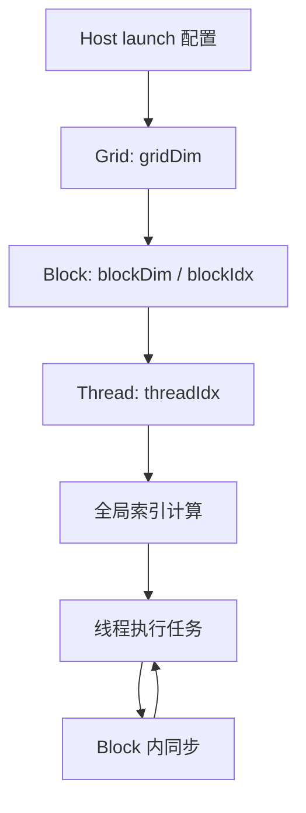

---
{"dg-publish":true,"permalink":"/CS工程体系/GPU编程/CUDA线程层次与执行模型-软件逻辑/","dg-note-properties":{}}
---

# 主题二：CUDA 线程层次与执行模型-软件逻辑

本篇主侧重点：CUDA 代码如何表达 Grid、Block、Warp 和 Thread 的关系。

硬件侧见 [[CS工程体系/GPU编程/CUDA线程层次与执行模型-硬件逻辑\|CUDA线程层次与执行模型-硬件逻辑]]。

## 软件结构图



CUDA 用三个维度表达索引，但一维、二维和三维只是编程组织方式。
硬件最终仍按线性线程编号把线程组成 Warp。

## 一次 kernel launch

```text
Host 选择 blockDim 和 gridDim
  → kernel 使用 blockIdx、threadIdx、blockDim 和 gridDim
  → 每个线程计算自己的全局索引
  → 线程检查索引是否越界
  → 线程执行自己的数据项
```

一维向量加法的常见索引形式：

```cpp
int i = blockIdx.x * blockDim.x + threadIdx.x;
if (i < n) {
    c[i] = a[i] + b[i];
}
```

这里的索引计算由 CUDA 代码完成。
Block 到哪个 SM、Warp 何时发射由 GPU 硬件决定。

## 同步范围

- `__syncwarp()`：协调一个 Warp 内的线程；
- `__syncthreads()`：协调同一个 Block 内的线程，并建立对应的共享内存可见性；
- 不同 Block 之间没有普通 kernel 内的隐式全局同步；需要拆成多个 kernel，或使用满足条件的 cooperative launch / cooperative groups。

同步调用通常要求参与的线程满足相同的控制流条件。
让部分线程进入、部分线程跳过同一个 Block 级同步点，可能造成未定义行为或死锁风险。

## 软件侧原则

- 先画出数据到线程的映射，再决定 Grid / Block 的维度；
- 给每个全局内存访问加边界判断；
- 把 Block 内协作和 Block 间依赖分开处理；
- 看到性能问题时，同时检查索引连续性、分支发散和资源占用；
- 不把 Block 的执行顺序当作程序语义。

## CUDA 场景

图像处理通常用二维 Grid / Block：

```text
blockIdx.x / threadIdx.x → 像素列
blockIdx.y / threadIdx.y → 像素行
```

每个线程处理一个像素，边界由图像宽高判断。若后续需要复用邻域像素，再引入共享内存和 Block 内同步。

