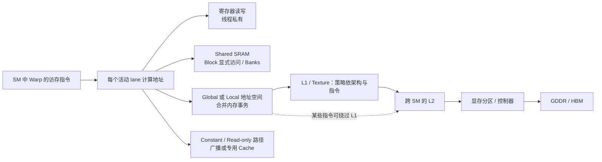

---
{"dg-publish":true,"permalink":"/CS工程体系/GPU编程/GPU内存层次-硬件逻辑/","dg-note-properties":{}}
---

# 主题三：GPU 内存层次-硬件逻辑

本篇解释**线程发出一次访存指令后，数据去哪里、何时回来、哪里会放大事务数**。先读 [[CS工程体系/GPU编程/GPU硬件结构-硬件逻辑\|GPU硬件结构-硬件逻辑]]，再按自己的芯片型号读对应架构图。

## 不是一条从寄存器到显存的直线



这些是**可选分支**。普通 global load 的数据返回线程寄存器；它不会自动先落入 Shared。Shared 是程序显式管理的片上 SRAM。Local memory 是**线程私有地址空间**，不保证驻留在片上；寄存器溢出或某些局部数组可能让它走设备内存路径，并被 Cache 缓存。

## 访问粒度：Warp 请求不等于一次 DRAM 事务

以 32 lane 的 Warp 各读取一个 4 字节 float 为例，在采用 32 字节访问分段的 CUDA 架构上：

```text
连续且对齐：lane 0..31 → 128 B 连续区间 → 4 个 32 B 分段
步长 128 B：lane 0..31 → 分散在 32 个分段 → 最多 32 个 32 B 请求
```

两种情况都只得到 128 B 有效数据，后一种却可能为更多分段付出传输和队列成本。Cache 命中、重用、写合并、分区映射会改变实际 DRAM 流量，所以不要把“32 个分段”直接说成“32 次 DRAM 读取”。Nsight Compute 的内存事务、L1/L2 命中与 DRAM 字节数可以区分这几层。

## Shared Memory：Bank 并行与冲突

Shared 被分成多个 bank，bank 让不同地址并行服务。一个 Warp 的多个线程若访问落在同一个 bank 的**不同地址**，访问可能被拆成多轮；同一地址的广播是另一种情况，不应直接算成冲突。

典型例子是转置：线程把行连续写入 Shared，然后按列读取。若 tile 的行跨度使每个 lane 都落在同一个 bank，列读取会串行化。给二维 tile 每行加一列 padding，常能改变 bank 映射，减少冲突；是否有效取决于数据类型、访问宽度和目标架构的 bank 规则。不能只记“加一列永远快”，要看 profiler 的 shared bank conflict 指标。

## Cache、可见性和生命周期

| 存储/缓存 | 主要作用 | 谁控制数据放入 | 常见误解 |
| --- | --- | --- | --- |
| 寄存器 | 线程私有的高速操作数 | 编译器分配；源码变量不保证总在寄存器 | “局部变量一定不访存” |
| Shared | Block 显式复用数据 | Kernel 代码或异步搬运 | “所有 Block 都能互读” |
| L1 / Texture | SM 附近的缓存和请求处理 | 硬件与指令缓存策略 | “所有 global load 必然命中 L1” |
| L2 | 多个 SM 共享的片上 Cache | 硬件与部分驻留策略 | “有共享 L2 就天然完成跨 Block 同步” |
| GDDR / HBM | 容量与持久的 Device 数据 | 分配器与内存控制器 | “显存带宽就是 kernel 实际带宽” |

Cache 是性能机制；跨线程的数据竞争与可见性要按 CUDA 内存模型、原子操作和同步范围处理。尤其不能把“两个 SM 都连着 L2”推导为“两个 Block 的普通读写有确定顺序”。

## 架构变化在哪条边上

| 架构 | 影响内存路径的关键变化 |
| --- | --- |
| Volta / Turing | L1 / Texture / Shared 组合容量及 carveout 不同；Turing 的 Warp / SM 上限更低。 |
| A100 / GA10x | `cp.async` 类异步 Global → Shared 路径；A100 与 GA10x 的 Shared、L2、显存差异很大。 |
| Ada | AD102 的片上 L2 大幅增加；Shared/SM 上限仍不同于 H100。 |
| Hopper | TMA 做多维 tile 的异步 Global ↔ Shared 搬运；Cluster 内有 DSM。 |
| Blackwell B200 | 数据中心 Tensor Core 有专用 TMEM；它不替代 Global、Shared 或寄存器。 |

## 面试追问

**“Global Memory 慢，为什么不把所有数据都放 Shared？”** Shared 容量有限、按 Block 分配、需要显式搬运和同步。数据只用一次时，搬入 Shared 可能只是额外开销；大 Shared 还会减少同驻留 Block 数。

**“寄存器越多越好吗？”** 更多寄存器可能避免 spill，但也降低可驻留 Warp。需要比较指令等待、spill 字节、occupancy 和总运行时间。

**“L2 很大是不是不需要合并访存？”** 不是。L2 命中减少显存流量，但 Warp 请求仍可能碎片化，耗费 L1/L2 事务和片上带宽。

## 来源

- [NVIDIA CUDA Best Practices Guide：Coalescing、Shared Memory Banks](https://docs.nvidia.com/cuda/cuda-c-best-practices-guide/index.html)
- [NVIDIA Ampere Tuning Guide](https://docs.nvidia.com/cuda/ampere-tuning-guide/index.html)
- [NVIDIA Hopper Tuning Guide](https://docs.nvidia.com/cuda/hopper-tuning-guide/index.html)
- [NVIDIA PTX ISA：Tensor Memory](https://docs.nvidia.com/cuda/parallel-thread-execution/index.html)
