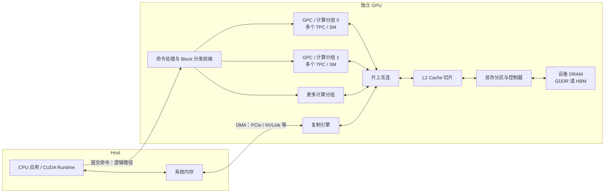
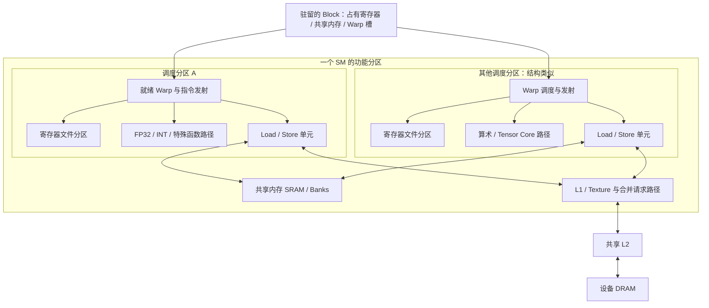

---
{"dg-publish":true,"permalink":"/CS工程体系/GPU编程/GPU硬件结构-硬件逻辑/","dg-note-properties":{}}
---

# 主题一：GPU 硬件结构-硬件逻辑

本篇主侧重点：从 Host 到 SM、从指令到显存的结构地图。软件侧见 [[CS工程体系/GPU编程/GPU硬件结构-软件逻辑\|GPU硬件结构-软件逻辑]]。

## 先定位架构和设备

“Ampere / Ada / Hopper / Blackwell”是架构家族，不是单一的硬件配置。A100 和 RTX 3090 都属于 Ampere，但计算资源、共享内存上限和显存不同。B200 和 RTX 50 系列也不能画成同一张内部结构图。

| 代表设备 | 架构与芯片例子 | Compute Capability | 单独的硬件图 |
| --- | --- | --- | --- |
| V100 | Volta / GV100 | 7.0 | [[CS工程体系/GPU编程/Volta与Turing-硬件结构\|Volta与Turing-硬件结构]] |
| RTX 20 | Turing / TU10x | 7.5 | [[CS工程体系/GPU编程/Volta与Turing-硬件结构\|Volta与Turing-硬件结构]] |
| A100 | Ampere / GA100 | 8.0 | [[CS工程体系/GPU编程/Ampere-A100与GA10x-硬件结构\|Ampere-A100与GA10x-硬件结构]] |
| RTX 30，例 RTX 3090 | Ampere / GA10x | 8.6 | [[CS工程体系/GPU编程/Ampere-A100与GA10x-硬件结构\|Ampere-A100与GA10x-硬件结构]] |
| RTX 40，例 RTX 4090 | Ada / AD10x | 8.9 | [[CS工程体系/GPU编程/Ada-AD10x-硬件结构\|Ada-AD10x-硬件结构]] |
| H100 | Hopper / GH100 | 9.0 | [[CS工程体系/GPU编程/Hopper-H100-硬件结构\|Hopper-H100-硬件结构]] |
| B200 | Blackwell 数据中心系列 | 10.0 | [[CS工程体系/GPU编程/Blackwell-B200与RTX50-硬件结构\|Blackwell-B200与RTX50-硬件结构]] |
| RTX 50 | Blackwell 消费级系列 | 12.0 | [[CS工程体系/GPU编程/Blackwell-B200与RTX50-硬件结构\|Blackwell-B200与RTX50-硬件结构]] |

芯片、产品 SKU、启用的 SM 数量和显存容量是不同层级。实际机器以设备属性和具体型号规格为准。

## 整颗 GPU：命令、计算和数据移动



这是职责与数据路径，不是某个芯片的 floorplan。GPC/TPC 数量及片上互连实现随芯片变化。Kernel launch 让 CPU 提交工作，GPU 前端分发 Block；线程的 load/store 指令进入 GPU 内存路径。Host 到 Device 复制由复制命令和数据移动引擎处理，不等同于 GPU 线程访存。

## 一个 SM 内部至少要看这些东西



图中两个分区只表示“SM 内有多个调度分区”，不是宣称各代只有两个。寄存器存线程私有状态；共享内存是 Block 显式管理的 SRAM；L1/L2 是硬件 Cache。Tensor Core 执行矩阵指令，不是每条 FP32 加法都会经过它。具体发射宽度、执行单元数量和吞吐量必须按目标架构查。

## 三条不同路径

### 指令与计算

```text
GPU 接受 launch → Block 分到 SM
→ 为 Block 分配寄存器、共享内存和 Warp 槽
→ 调度器挑一个就绪 Warp
→ 指令发射到 FP32 / INT / LSU / Tensor Core 等路径
→ Block 完成，释放资源
```

`c[i] = a[i] + b[i]` 包含地址计算、加载、加法和存储，不能当成单条“GPU 加法”。访存依赖未完成时，该 Warp 暂时不可发射相关指令；调度器可以选其他就绪 Warp。

### 全局内存 load/store

```text
Warp 的活动线程各自产生地址
→ 地址形成若干内存事务
→ L1 / L2 可能命中
→ 未命中的事务进入显存分区 / DRAM
→ 加载数据返回线程寄存器
```

访问地址、对齐与事务粒度决定实际传输量。**寄存器、共享内存、L1、L2 不是必然串联的路径**：普通全局 load 不会自动经过共享内存；共享内存由代码显式访问，或由支持的异步搬运机制参与。

### Host 与 Device 搬运

```text
Host / Device 缓冲区 → CUDA 复制命令
→ 复制引擎与互连 / DMA 路径
→ 数据写入另一侧内存
→ Event 或同步点观察完成
```

独立 GPU 的系统 DRAM 和设备 DRAM 通常是不同物理内存。Unified Memory、NVLink-C2C 等改变访问和迁移方式，因此“总是先经 PCIe 显式复制”不成立。

## 面试追问：先答因果链

| 问题 | 硬件因果链 |
| --- | --- |
| 为什么 100% occupancy 不保证最快？ | Occupancy 是驻留 Warp 比例；还要看就绪 Warp、指令吞吐、访存合并、Cache 和带宽。 |
| 为什么共享内存能加速部分矩阵乘？ | Tile 只从全局内存加载一次，在 Block 内复用；代价是共享内存占用和同步。 |
| 为什么分支发散会慢？ | 同一 Warp 的不同路径分段发射，部分 lane 暂时不工作。 |
| 为什么 Block 不能随意相互等待？ | Block 分配次序不保证，甚至未必同时驻留；相互等待可能卡住资源。 |
| 为什么连续地址通常更快？ | Warp 内访问容易合并成较少事务；还需看访问宽度、对齐和 Cache。 |
| 为什么换 GPU 要重新测？ | 资源上限、Cache、执行单元、Tensor Core 指令和显存带宽都可能变。 |

## 权威资料

- [NVIDIA CUDA GPU Compute Capability：设备型号与 CC 对照](https://developer.nvidia.com/cuda-gpus)
- [NVIDIA Ampere Tuning Guide](https://docs.nvidia.com/cuda/ampere-tuning-guide/index.html)
- [NVIDIA Volta Tuning Guide](https://docs.nvidia.com/cuda/volta-tuning-guide/index.html)
- [NVIDIA Turing Tuning Guide](https://docs.nvidia.com/cuda/turing-tuning-guide/index.html)
- [NVIDIA Ada Tuning Guide](https://docs.nvidia.com/cuda/ada-tuning-guide/index.html)
- [NVIDIA Hopper Tuning Guide](https://docs.nvidia.com/cuda/hopper-tuning-guide/index.html)
- [NVIDIA Blackwell Tuning Guide](https://docs.nvidia.com/cuda/blackwell-tuning-guide/index.html)
