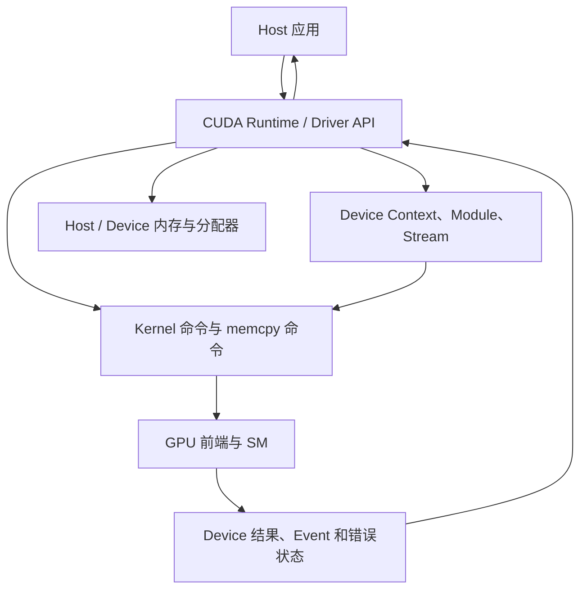

---
{"dg-publish":true,"permalink":"/CS工程体系/GPU编程/GPU硬件结构-软件逻辑/","dg-note-properties":{}}
---

# 主题一：GPU 硬件结构-软件逻辑

本篇主侧重点：CUDA 如何发现 GPU、建立执行环境并使用 GPU 资源。

硬件结构见 [[CS工程体系/GPU编程/GPU硬件结构-硬件逻辑\|GPU硬件结构-硬件逻辑]]。

## 先区分两个动作

```cpp
// 函数的定义：函数体准备在 GPU 上执行
__global__ void work() {
    // GPU 线程执行这里
}

// 函数的调用方式：CPU 请求 GPU 执行它
work<<<1, 1>>>();
```

`work` 是 kernel。
`work<<<1, 1>>>()` 是 kernel launch。
前面的 CPU 代码负责提交请求；`work` 函数体由 GPU 执行。

这里的 `1, 1` 先只理解成“1 个执行组，每组 1 个线程”。后续主题再解释执行组为什么叫 Block，以及多个线程如何组成 Warp。

## 软件结构图：Host、Runtime 和 Device



图中的 Runtime API 是软件入口。
真正的命令执行、线程调度、访存和同步由 GPU 硬件完成。

## CUDA 建立执行环境

```text
查询设备数量和属性
  → 选择 Device
  → Runtime 懒创建或显式创建 Context
  → 编译或加载 CUDA Module
  → 分配 Device 内存和 Stream
  → 提交 kernel 或数据传输命令
```

`cudaDeviceProp` 等属性可以帮助判断 SM 数量、最大线程数、共享内存和显存容量。
这些属性描述设备能力，不代表一个 kernel 一定能同时占满所有资源。

## Host 提交一次 kernel

```text
Host 计算 Grid、Block、参数和动态共享内存大小
  → 调用 kernel launch 语法
  → Runtime 把参数编码为命令
  → 命令进入指定 Stream
  → Host 通常继续执行
  → GPU 异步执行 Block
  → 同步、Event 或后续依赖观察完成
```

kernel launch 返回成功，只表示命令已经被接受；异步执行中的非法访存、越界和执行失败可能在后续同步或错误查询时报告。

## 软件维护的状态

- 当前 Device 和 Context；
- 已加载的 Module、kernel 函数和参数布局；
- Device 指针、Host 缓冲区和内存所有权；
- Stream、Event 以及它们之间的依赖；
- 已提交命令、完成状态和最近一次错误。

## CUDA 场景

向量加法的 Host 侧路径通常是：

```text
分配 Host 输入和 Device 缓冲区
  → 把输入复制到 Device
  → 以足够覆盖元素数量的 Grid / Block 启动 kernel
  → 同步并检查错误
  → 把结果复制回 Host
  → 释放 Stream、Device 内存和 Host 内存
```

先把这条路径跑通，再进入内存层次和性能专题。

