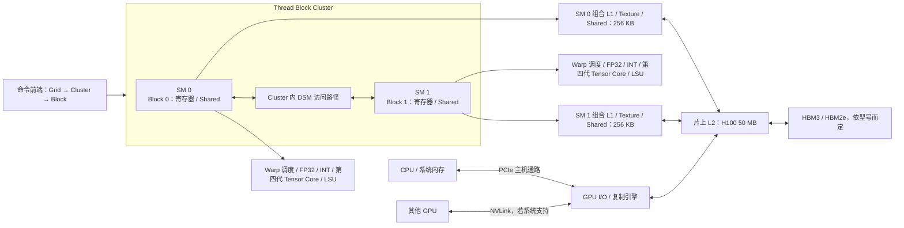
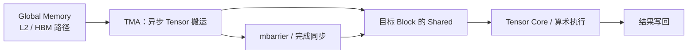

---
{"dg-publish":true,"permalink":"/CS工程体系/GPU编程/Hopper-H100-硬件结构/","dg-note-properties":{}}
---

# Hopper：H100 / GH100 硬件结构

定位：H100 为 Compute Capability 9.0。与 A100 相比，新增的硬件路径主要是 Thread Block Cluster、分布式共享内存（DSM）和 Tensor Memory Accelerator（TMA）；第四代 Tensor Core 支持新的矩阵指令。返回 [[CS工程体系/GPU编程/GPU硬件结构-硬件逻辑\|GPU硬件结构-硬件逻辑]]。

图中“组合 L1 / Shared → L2”只表示全局内存请求的 Cache 出口；本地 Shared 与 DSM 的访问有各自路径。

## 芯片和 Cluster 路径

Cluster 是可选层级。普通 kernel 仍是 Grid → Block → Warp → Thread；只有显式使用 Cluster 的程序，才需要考虑 Cluster 内的协作与 DSM。DSM 允许一个 Block 访问同一 Cluster 中其他 Block 的共享内存，**不表示整张 GPU 的所有共享内存变成一个全局可读的 SRAM**。

## TMA：给 tile 搬运增加一条硬件路径

TMA 可以搬运 1D 到 5D tensor tile，减少由普通线程逐元素做地址计算、寄存器中转和搬运指令的开销。发起异步搬运后，必须等待完成并建立正确的可见性关系才能消费 Shared 中的数据。它让“计算当前 tile、搬运下一个 tile”的流水更自然，但流水是否获益取决于 tile、资源占用、带宽和同步成本。

Hopper 的第四代 Tensor Core 可通过架构对应的矩阵指令执行 warpgroup 级矩阵计算；它不是 CUDA 编译器把普通标量循环无条件替换出来的单元。

## 一个 SM 的资源边界

| 指标 | H100 / 9.0 |
| --- | ---: |
| 驻留 Warp 上限 | 64 |
| 32 位寄存器数 | 64 K |
| 驻留 Block 上限 | 32 |
| 共享内存容量上限 | 228 KB |
| 单 Block 可用共享内存上限 | 227 KB |
| 组合 L1 / Texture / Shared 容量 | 256 KB |

Cluster kernel 还受每个 Cluster 的 Block 数、GPC 与 SM 可用量影响；不能只用“每 SM 几个 Block”的旧公式估 occupancy。官方建议用 `cudaOccupancyMaxActiveClusters` 计算。

## 面试追问

**“有了 DSM，为什么还需要 L2？”** DSM 只覆盖同一 Cluster 中显式协作的 Block，容量来自有限的共享内存，生命周期也受 Cluster 约束。L2 是更大范围的硬件 Cache，服务普通全局内存路径和不同 SM 的访问。

**“TMA 异步后，消费者线程能马上读 Shared 吗？”** 不能。发出搬运请求不代表完成；必须按对应 barrier / 异步完成规则等待，否则可能读到旧数据或未完成的数据。

## 来源

- [NVIDIA Hopper Tuning Guide：TMA、Thread Block Clusters、Occupancy、Memory System](https://docs.nvidia.com/cuda/hopper-tuning-guide/index.html)
- [NVIDIA PTX ISA：矩阵与异步指令](https://docs.nvidia.com/cuda/parallel-thread-execution/index.html)
