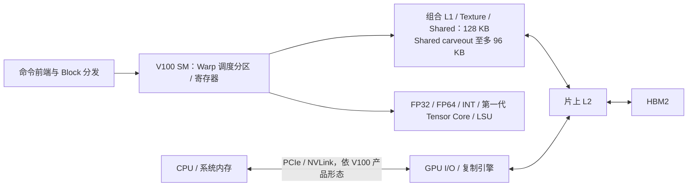
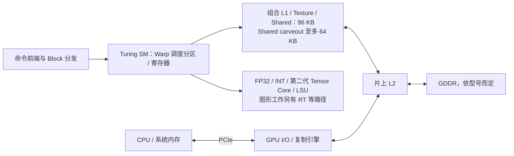

---
{"dg-publish":true,"permalink":"/CS工程体系/GPU编程/Volta与Turing-硬件结构/","dg-note-properties":{}}
---

# Volta V100 与 Turing RTX 20：CUDA 硬件演进基线

这两代常用于回答“独立线程调度、Tensor Core、L1/Shared 合并、Occupancy 上限从何而来”。Volta V100 通常是 Compute Capability 7.0；Turing RTX 20 系列通常是 7.5。返回 [[CS工程体系/GPU编程/GPU硬件结构-硬件逻辑\|GPU硬件结构-硬件逻辑]]。

图中“组合 L1 / Shared → L2”只表示全局内存请求的 Cache 出口；本地 Shared 访问不会自动进入 L2。

## Volta / V100：数据中心 GPU

Volta 的重要变化是 Independent Thread Scheduling：Warp 内线程有更独立的执行状态。程序不能再把“同一 Warp 内自然同步”当作正确性依据。Tensor Core 开始提供专门的矩阵计算路径；普通 FP32 加法仍走 FP32 路径。

## Turing / RTX 20：消费级 GPU

Turing 的计算路径与图形路径共享芯片资源。对纯 CUDA kernel 的硬件分析，先看 SM、Cache、显存；RT Core 的光线追踪能力并不会自动加速普通 CUDA 加法。

## 对比：同样 64 K 寄存器，驻留能力仍不同

| 每 SM 的公开上限 | V100 / 7.0 | Turing / 7.5 |
| --- | ---: | ---: |
| 驻留 Warp 上限 | 64 | 32 |
| 32 位寄存器数 | 64 K | 64 K |
| 驻留 Block 上限 | 32 | 16 |
| 共享内存容量上限 | 96 KB | 64 KB |
| 组合 L1 / Texture / Shared 容量 | 128 KB | 96 KB |

对一个 256 线程 Block，即 8 Warp：单看 Warp 上限，V100 理论可放 8 个这种 Block，Turing 最多 4 个；寄存器、共享内存或架构 Block 上限还可能进一步降低实际数量。

## 面试追问

**“Volta 引入独立线程调度后，同一个 Warp 内还需要同步吗？”** 当线程之间有数据依赖或对执行顺序有要求时，需要明确使用对应同步机制；不能仅凭同一 Warp 假定 lockstep 正确性。

**“Turing 为什么有 64 KB Shared，而组合缓存是 96 KB？”** L1 与 Shared 从组合数据存储中 carve out，不是两块容量简单相加。Turing 支持 64 KB Shared + 32 KB L1，或 32 KB Shared + 64 KB L1 的配置。

## 来源

- [NVIDIA Volta Tuning Guide：Independent Thread Scheduling、Occupancy、Memory](https://docs.nvidia.com/cuda/volta-tuning-guide/index.html)
- [NVIDIA Turing Tuning Guide：Occupancy、Unified L1 / Shared Memory](https://docs.nvidia.com/cuda/turing-tuning-guide/index.html)
