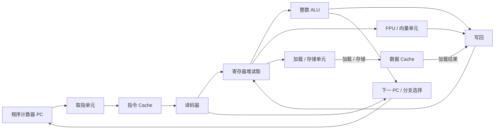

---
{"dg-publish":true,"permalink":"/CS工程体系/操作系统/CPU 核心如何执行指令-硬件逻辑/","dg-note-properties":{}}
---

# 主题二：CPU 核心如何执行指令-硬件逻辑

本篇主侧重点：CPU 的取指、执行和写回路径。

软件侧见 [[CS工程体系/操作系统/CPU 核心如何执行指令-软件逻辑\|CPU 核心如何执行指令-软件逻辑]]。

## 硬件主图



这是教学用的逻辑路径。
它不表示单周期执行。
真实核心会把路径拆成多个流水级。
乱序核心还会加入寄存器重命名、保留站和提交阶段。

本图省略虚拟地址到物理地址的转换。
取指和数据访问的地址转换见 [[CS工程体系/操作系统/页表 和 页-硬件逻辑\|页表 和 页-硬件逻辑]]。

## 一条指令的硬件路径

```text
PC 提供当前取指地址
  → 指令 Cache 取指
  → 译码器识别操作和操作数
  → 寄存器提供输入
  → ALU / FPU / 加载存储单元执行
  → 算术结果写回寄存器，或通过数据 Cache 完成加载 / 存储
  → 顺序执行时 PC 更新到下一条；分支、调用或异常时由控制逻辑选择新 PC
```

## 业务场景

函数调用、循环和分支都会变成指令序列。
循环反复访问同一段代码时，指令 Cache 命中会减少取指等待。
分支预测错误时，流水线会丢弃已取出的指令。
核心随后重新取指。
