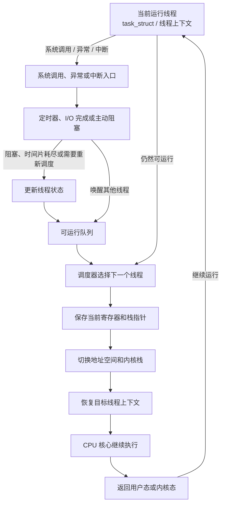

---
{"dg-publish":true,"permalink":"/CS工程体系/操作系统/CPU 核心如何执行指令-软件逻辑/","dg-note-properties":{}}
---

# 主题二：CPU 核心如何执行指令-软件逻辑

本篇主侧重点：内核如何管理线程上下文，并让线程使用 CPU 核心。

CPU 的取指、译码、执行和写回路径见 [[CS工程体系/操作系统/CPU 核心如何执行指令-硬件逻辑\|CPU 核心如何执行指令-硬件逻辑]]。

## 软件结构图



图中的 `SAVE`、`SWITCH` 和 `LOAD` 表示上下文切换的内核动作。
内核只有在当前线程阻塞或调度器要求重新调度时才选择其他线程。

## 线程上下文

线程上下文通常包括：

- 程序计数器；
- 栈指针；
- 通用寄存器；
- 状态寄存器；
- 浮点和向量寄存器；
- 所属进程的地址空间信息。

进程级地址空间状态可以由多个线程共享。
线程级寄存器状态由每个线程分别保存。

## 上下文切换路径

```text
线程进入就绪队列
  → 调度器选择线程和目标核心
  → 保存当前线程的寄存器和程序计数器
  → 必要时保存浮点 / 向量状态
  → 切换地址空间根或地址空间标签
  → 恢复目标线程上下文
  → 从恢复的程序计数器继续执行
```

上下文切换保存的是内核需要恢复的软件可见状态。
流水线、分支预测器和 Cache 状态由硬件按架构规则处理。

## 内核入口与返回

线程执行系统调用、发生异常或收到外部中断时，CPU 根据架构进入内核入口。
内核保存必要的现场，判断事件类型并执行对应路径。
处理完成后，内核恢复现场，让线程继续执行，或选择另一个线程返回核心。

Linux 等内核通常在入口和返回路径检查是否需要重新调度。
系统调用返回不等于一定发生上下文切换。

## 调度器管理的状态

调度器通常维护：

- 可运行线程队列；
- 阻塞原因和等待队列；
- 时间片或调度优先级；
- CPU 亲和性；
- 当前核心正在运行的线程。

定时器事件、I/O 完成和锁竞争都会改变线程状态。

## 业务场景

频繁上下文切换会增加寄存器保存、地址空间切换和 Cache 局部性损失。
线程数量、阻塞方式和 CPU 亲和性都会影响服务延迟。
