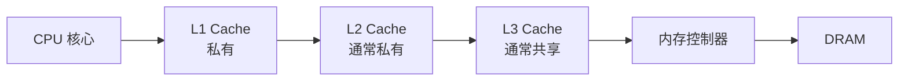

---
{"dg-publish":true,"permalink":"/CS工程体系/操作系统/Cache 和内存层次-硬件逻辑/","dg-note-properties":{}}
---

# 主题三：Cache 和内存层次-硬件逻辑

本篇主侧重点：Cache 层级、Cache line 和一致性硬件。

软件侧见 [[CS工程体系/操作系统/Cache 和内存层次-软件逻辑\|Cache 和内存层次-软件逻辑]]。

## 硬件主图



Cache 按固定大小的 **Cache line** 传输数据。
Cache 不按单个变量传输数据。
L1、L2、L3 越靠近核心，容量通常越小，延迟通常越低。

处理器不一定具备三级 Cache。
Cache 的层数和私有 / 共享关系由处理器实现决定。

## 关键数据路径

```text
核心发出地址
  → 查 L1
  → L1 miss，查 L2
  → L2 miss，查共享 L3
  → L3 miss，经内存控制器访问 DRAM
  → 取回一个 Cache line
  → 逐级填充并交给核心
```

局部性决定 Cache 是否有效：

- **时间局部性**：程序会再次访问刚访问过的数据。
- **空间局部性**：程序会访问刚访问地址附近的数据。

常见写策略：

- **写回**：先改 Cache line，淘汰时再写回下一级存储层次。
- **写直达**：写 Cache 的同时向下一级缓存或内存传播。

## 业务场景

- 数据库扫描连续记录时具有空间局部性。
- 连续扫描比随机访问更容易命中 Cache 和预取机制。
- 多线程修改同一个 Cache line 时，即使修改不同变量，也会产生伪共享风险。
- 顺序访问通常比随机访问快。
- Cache line、硬件预取和 DRAM 行缓冲会提高顺序访问的效率。
