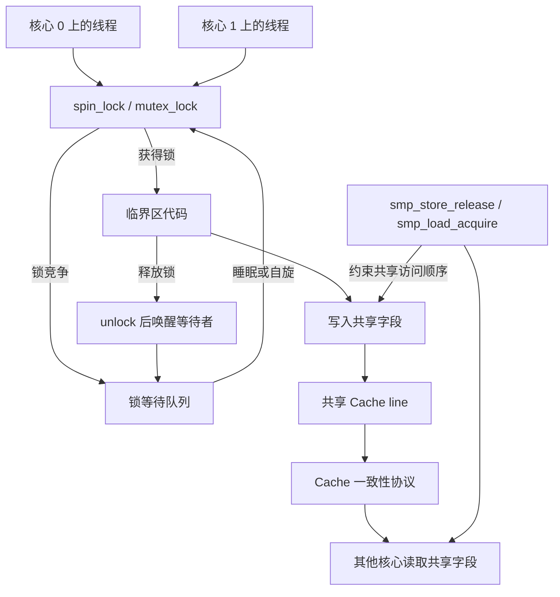

---
{"dg-publish":true,"permalink":"/CS工程体系/操作系统/Cache 和内存层次-软件逻辑/","dg-note-properties":{}}
---

# 主题三：Cache 和内存层次-软件逻辑

本篇主侧重点：内核和并发程序如何使用 Cache 一致性、原子指令和内存序。

Cache 层级、Cache line 和一致性协议见 [[CS工程体系/操作系统/Cache 和内存层次-硬件逻辑\|Cache 和内存层次-硬件逻辑]]。

## 软件结构图



图中的锁和原子操作属于内核代码。
Cache 一致性只负责传播 Cache line 的状态变化。
它不负责选择锁的持有者，也不负责组织等待队列。

## 共享数据的内核规则

内核通过以下机制组织跨核心共享数据：

- 原子读改写；
- 自旋锁和睡眠锁；
- 内存屏障；
- acquire / release 等内存序；
- 每核心数据和共享数据的划分。

Cache 一致性提供共享内存的硬件基础。
它不决定哪个线程先获得锁，也不负责唤醒等待线程。

## 共享数据路径

```text
线程写入共享数据
  → 原子指令或锁建立访问顺序
  → Cache 一致性传播 Cache line 的新状态
  → 内存序约束后续读写
  → 其他核心读取新值
```

原子性、Cache 一致性和内存序共同决定并发访问是否正确。
单独依赖 Cache 一致性不能建立完整的线程同步关系。

自旋锁竞争时，线程可以持续执行原子指令并等待锁释放。
互斥锁竞争时，内核通常把线程放入等待队列并让线程睡眠。
锁释放后，内核再唤醒等待线程。

这里的“内存序”有两个相关层次：

- **CPU 架构内存序**：规定核心对内存访问的可见顺序，并提供内存屏障指令；
- **C++ 内存序**：`std::atomic` 使用的语言层规则，例如 `relaxed`、`acquire`、`release` 和 `seq_cst`。

C++ 内存序会影响编译器生成的原子操作和屏障。
编译器再根据目标 CPU 的内存模型选择具体机器指令。
两者表达的是同一类顺序约束，但抽象层级不同。

## 内核数据结构的布局

内核会根据访问模式安排数据布局：

- 高频读取的数据尽量保持局部；
- 每核心计数器减少共享写入；
- 经常同时访问的数据放在相近 Cache line；
- 不同核心频繁修改的数据避免落在同一 Cache line。

## 业务场景

多线程队列、数据库缓冲池和引用计数器都会受到 Cache miss、伪共享和锁竞争影响。
减少共享写入和不必要的跨核心迁移，通常可以降低延迟。
