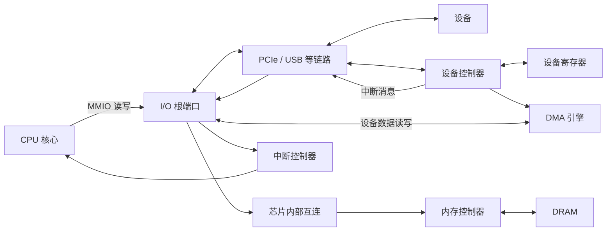

---
{"dg-publish":true,"permalink":"/CS工程体系/操作系统/I-O、MMIO、DMA 和中断-硬件逻辑/","dg-note-properties":{}}
---

# 主题七：I/O、MMIO、DMA 和中断-硬件逻辑

本篇主侧重点：MMIO、DMA、设备链路和中断的硬件路径。

软件侧见 [[CS工程体系/操作系统/I-O、MMIO、DMA 和中断-软件逻辑\|I-O、MMIO、DMA 和中断-软件逻辑]]。

## 相关概念

- **MMIO**：把设备寄存器映射到物理地址空间。CPU 用加载和存储指令访问这些寄存器。
- **PCIe**：连接 CPU、内存和外设的高速串行互连协议。PCIe 用数据包传输读写请求、DMA 请求和中断消息。
- **Root Complex**：处理器侧的 PCIe 根复合体。它把 PCIe 设备接入芯片内部互连。
- **Root Port**：根复合体连接一条 PCIe 链路的端口。
- **Endpoint**：PCIe 链路另一端的设备功能，例如网卡、NVMe 控制器或 GPU。
- **配置空间**：PCIe 设备用于枚举、能力发现和配置的寄存器空间。
- **BAR**：设备在配置空间中声明的基址寄存器。BAR 描述设备寄存器或设备内存需要的地址范围。
- **DMA**：设备直接读写系统内存的机制。CPU 不必逐字节搬运数据。
- **IOMMU**：转换并检查设备发出的 DMA 地址。它可以限制设备只能访问指定内存。
- **MSI / MSI-X**：设备通过写入消息地址来报告中断的 PCIe 机制。

MMIO 是访问设备寄存器的方法。
PCIe 是传输请求的链路和协议。
DMA 是设备访问内存的机制。
中断是设备报告事件的机制。

## 硬件主图



### CPU 访问设备寄存器

```text
CPU 发出加载或存储指令
  → MMU 把虚拟地址转换为 MMIO 物理地址
  → I/O 根复合体或根端口
  → PCIe 链路
  → 设备 Endpoint 的寄存器
```

### 设备访问系统内存

```text
设备控制器发出 DMA 请求
  → PCIe 链路
  → I/O 根复合体
  → IOMMU（如果平台启用）
  → 芯片内部互连
  → 内存控制器
  → DRAM
```

### 设备报告完成

```text
设备更新完成状态
  → MSI / MSI-X 或其他中断消息
  → 根端口和中断路径
  → 中断控制器
  → CPU
```

- **MMIO**：设备寄存器位于 CPU 可访问的地址范围内。
  核心用加载和存储指令读写这些寄存器。
  部分架构还提供端口 I/O。
- **DMA**：设备控制器直接发起内存读写。
  CPU 不必逐字节搬运数据。
- **中断**：设备控制器通知 CPU 完成、错误或新数据事件。

PCIe 使用 MSI / MSI-X 中断消息。
消息经过设备链路到达根端口。
中断控制器再转发消息。
USB 设备由主机控制器完成传输。
主机控制器再向系统报告事件。
USB 设备不直接向 CPU 发中断。

中断源和中断控制器的硬件路径见 [[CS工程体系/操作系统/中断专题-硬件逻辑\|中断专题-硬件逻辑]]。

## 关键数据路径：网卡接收数据

```text
网卡
  → 设备控制器接收队列
  → DMA 引擎
  → 设备链路和 I/O 根端口
  → 芯片内部互连
  → 内存控制器
  → DRAM 中的接收缓冲区
  → 中断或轮询报告完成状态
```

## 业务场景

- 网卡用 DMA 把报文写入 DRAM。
- 文件读写完成时，设备控制器记录完成状态并产生通知。
- 高速设备可以频繁产生中断，平台因此提供中断合并或轮询机制。
