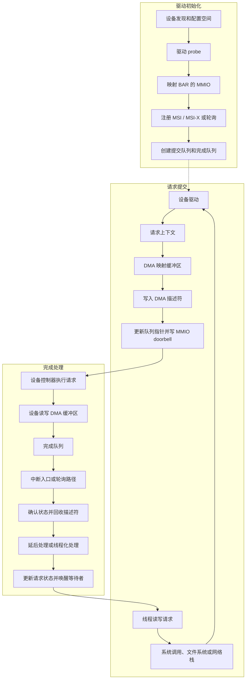

---
{"dg-publish":true,"permalink":"/CS工程体系/操作系统/I-O、MMIO、DMA 和中断-软件逻辑/","dg-note-properties":{}}
---

# 主题七：I/O、MMIO、DMA 和中断-软件逻辑

本篇主侧重点：内核和驱动如何配置设备、管理 DMA，并处理完成事件。

MMIO、DMA、设备链路和中断请求的硬件路径见 [[CS工程体系/操作系统/I-O、MMIO、DMA 和中断-硬件逻辑\|I-O、MMIO、DMA 和中断-硬件逻辑]]。

## 相关概念

- **设备发现**：内核读取 PCIe 配置空间，识别设备类型、能力和资源需求。
- **BAR 映射**：内核根据 BAR 分配地址，并把设备寄存器映射到内核地址空间。
- **MMIO 访问**：驱动用映射后的地址读取状态或写入控制寄存器。
- **DMA 映射**：内核把缓冲区转换成设备可以使用的 DMA 地址，并管理缓冲区所有权。
- **DMA 描述符**：设备队列中记录缓冲区地址、长度和状态的条目。
- **IOMMU 映射**：内核为设备建立 DMA 地址到物理内存的转换和访问范围。
- **MSI / MSI-X**：驱动配置设备使用的消息中断向量。设备完成工作后发送中断消息。

驱动通过 MMIO 配置设备。
设备通过 DMA 传输数据。
设备通过中断或轮询报告状态。

## 软件结构图



设备发现和 I/O 请求是两条相关路径。
设备发现建立驱动使用的硬件接口。
I/O 请求使用已经建立的接口提交和完成操作。
图中的 `probe`、DMA 映射、描述符回收和等待者唤醒都是内核代码行为。

## I/O 软件路径

```text
线程发起读写请求
  → 内核选择文件系统或网络路径
  → 驱动通过 MMIO 写入设备寄存器并准备 DMA 描述符
  → 线程进入等待状态，或继续处理其他工作
  → 设备控制器执行 DMA
  → 设备通过中断或轮询报告完成状态
  → 内核确认状态、回收队列项并唤醒等待者
```

## 驱动维护的状态

驱动通常维护：

- 设备初始化状态和能力；
- 提交队列和完成队列；
- DMA 缓冲区的所有权；
- 描述符的准备、提交和回收状态；
- 中断状态和错误状态；
- 等待 I/O 的线程或回调。

驱动把内核缓冲区和设备队列转换成设备能理解的格式。
内核负责缓冲区所有权、等待队列和完成状态。

## DMA 所有权

```text
内核准备缓冲区和描述符
  → 把 DMA 地址和长度交给设备
  → 设备读写缓冲区
  → 设备报告完成
  → 内核确认设备已经停止使用缓冲区
  → 驱动回收描述符并交付数据
```

DMA 一致性、IOMMU 和内存屏障的具体要求取决于平台和设备。

驱动不得在设备仍然使用缓冲区时回收缓冲区。
驱动必须按平台规则处理 DMA 地址、缓存可见性和内存顺序。

## 中断后的软件处理

中断入口中的最小处理通常包括读取或确认设备状态、记录完成事件和安排后续工作。
较重的处理可以延后到其他内核上下文。
内核还要根据完成状态唤醒等待者，或向上层返回错误。

## 业务场景

高速网卡会使用多队列、批处理、中断合并或轮询降低每个报文的处理开销。
文件读写延迟同时受到设备队列、DMA、完成事件和等待线程调度的影响。
