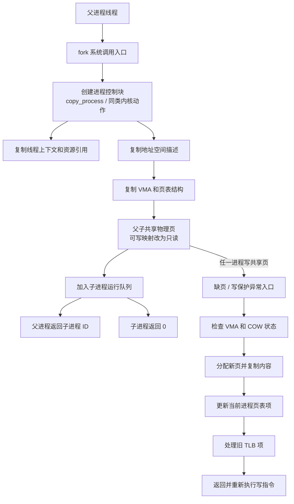

---
{"dg-publish":true,"permalink":"/CS工程体系/操作系统/fork-软件逻辑/","dg-note-properties":{}}
---

# 主题六：fork-软件逻辑

本篇主侧重点：内核如何创建进程，并通过写时复制共享页面。

写时复制依赖的页表权限和缺页异常见 [[CS工程体系/操作系统/fork-硬件逻辑\|fork-硬件逻辑]]。

## 软件结构图



这张图把 `fork` 分成创建路径和写时复制路径。
创建子进程不等于立即复制全部数据页。

## `fork` 的内核状态

内核需要为子进程建立或引用：

- 进程控制信息；
- 线程执行上下文；
- 地址空间描述；
- 页表结构；
- 物理页引用计数；
- 文件描述符和其他资源引用。

子进程获得父进程地址空间的逻辑副本。
父子进程先共享满足条件的物理页。

## 创建路径

```text
父进程发起 fork 系统调用
  → 内核创建子进程控制信息
  → 建立子进程线程上下文
  → 建立或复制地址空间和页表结构
  → 父子共享私有可写页面
  → 把共享映射改为只读并更新引用计数
  → 分别设置父子进程的返回值
  → 把子进程放入调度队列
```

父进程通常得到子进程 ID。
子进程通常得到返回值 0。
调度器决定父子进程的运行顺序。
程序不能依赖固定顺序。

典型 Linux 内核会在创建路径中分配进程控制信息、复制地址空间引用，并把子进程加入调度器管理的运行队列。
具体函数名称会随内核版本变化。

## 写时复制路径

```text
父进程或子进程写入共享页
  → CPU 产生缺页或保护异常
  → 内核检查地址区域和 COW 状态
  → 分配新的物理页并复制旧内容
  → 修改当前进程的页表项
  → 更新物理页引用计数
  → 使旧 TLB 项失效
  → 返回并重新执行写指令
```

硬件报告异常。
内核判断异常是否来自合法的写时复制映射，并完成页面复制。

内核必须在更新页表和处理 TLB 后，才可以重新执行故障写指令。

## 语义边界

- `fork` 不会立即复制所有数据页；
- COW 主要用于私有、可写的用户页；
- 共享内存、只读映射和设备映射遵循不同规则；
- 多线程进程调用 `fork` 后，子进程只保留调用线程；
- 很多程序让子进程尽快执行 `exec`；
- `vfork`、`posix_spawn` 和其他创建优化遵循不同规则。

## 业务场景

Shell 和服务器常用 `fork` 后接 `exec` 创建新程序。
COW 可以避免在 `exec` 前复制大块内存。
父子进程频繁修改共享页时，会触发大量缺页处理和物理页复制。
