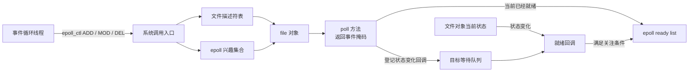
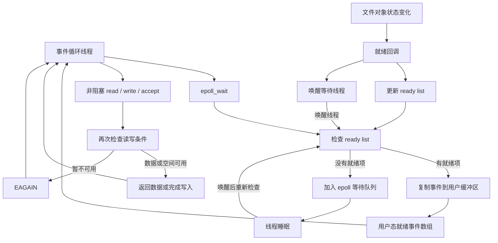
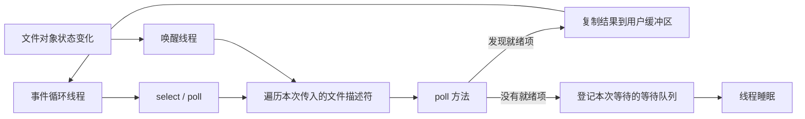

---
{"dg-publish":true,"permalink":"/CS工程体系/操作系统/io多路复用-软件逻辑/","dg-note-properties":{}}
---

# 主题十一：I/O 多路复用-软件逻辑

本篇主侧重点：内核如何等待和分发 I/O 事件。

底层设备路径见 [[CS工程体系/操作系统/io多路复用-硬件逻辑\|io多路复用-硬件逻辑]]。

I/O 多路复用属于软件行为。
它不放进硬件主图。
内核管理多个设备或文件描述符的状态。
一个线程可以等待多个 I/O 事件。

## 软件结构图：注册、等待、唤醒和消费



这张图展示 `epoll` 的长期注册关系。
`epoll_ctl` 保存兴趣集合，并把目标文件对象的状态变化连接到 ready list。

### 一次 `epoll_wait` 等待和消费



`epoll_wait` 返回的是就绪通知。
真正的 `read`、`write` 或 `accept` 仍然要再次检查文件对象状态。

### `select` 和 `poll` 的一次等待



三张图以内核常见的事件等待模型为主。
`epoll` 保存持久的兴趣集合和就绪集合。
`select` 和 `poll` 通常在每次等待时遍历文件描述符并检查状态。
设备仍然通过设备控制器、DMA 和中断或轮询传输数据。
I/O 多路复用只改变内核怎样等待和分发事件。

“可读”表示读取操作当前不会按通常语义阻塞。
“可写”表示写入操作当前不会按通常语义阻塞。
这两个状态不表示数据已经复制到用户缓冲区。
这两个状态也不表示一次完整 I/O 已经完成。
文件类型会影响就绪语义。
对 `select` 和 `poll`，普通文件会报告为就绪。
Linux `epoll` 不用于普通文件。

## 内核维护的关键对象

- **文件描述符和 `file` 对象**：把用户态编号连接到内核文件对象。
- **兴趣集合**：记录线程关注的文件对象和事件类型，例如可读、可写、错误和挂断。
- **等待队列关系**：把文件对象的状态变化连接到等待线程或事件回调。
- **就绪集合**：保存当前已经满足事件条件的对象。Linux `epoll` 使用 ready list 保存这类对象。
- **等待线程队列**：保存暂时没有就绪事件、可以进入睡眠的线程。

内核必须在睡眠前再次检查就绪状态。
这个顺序可以避免线程错过已经发生的唤醒事件。

## 注册、等待和唤醒

### 注册阶段

调用 `epoll_ctl(ADD)` 时，内核保存关注事件，并为目标文件对象登记等待队列关系。
内核还会检查目标对象当前是否已经就绪。
已经就绪时，内核把对象加入 ready list。

在 Linux 中，文件对象的 `poll` 方法返回事件掩码。
常见掩码包括 `POLLIN`、`POLLOUT`、`POLLERR` 和 `POLLHUP`。
`poll` 方法还可以通过内核提供的回调登记等待队列。

`select` 和 `poll` 通常不保存长期兴趣集合。
它们在每次等待调用中重新传入文件描述符集合，并重新建立本次等待关系。

### 等待阶段

调用 `epoll_wait` 时，内核先检查 ready list。
ready list 有事件时，内核复制事件并返回。
ready list 没有事件时，内核把当前线程放入等待队列并让线程睡眠。

调用 `select` 或 `poll` 时，内核遍历文件描述符。
内核调用每个文件对象的 `poll` 方法检查当前状态。
没有文件描述符就绪时，线程进入睡眠。

### 唤醒阶段

网络栈、文件系统或设备驱动改变文件对象状态时，会唤醒相关等待队列。
`epoll` 的回调会把满足关注条件的对象加入 ready list，并唤醒等待 `epoll_wait` 的线程。
线程被唤醒后，内核必须重新检查状态，再把结果复制到用户缓冲区。

## 典型 Linux 内核动作

下面的函数名表示典型动作。
具体函数名和调用层级会随内核版本变化。

- 文件对象的 `poll` 方法通过 `poll_wait()` 登记等待队列。
- 网络栈、文件系统或驱动通过 `wake_up*()` 唤醒等待队列。
- `epoll` 回调把就绪对象加入 ready list，并唤醒等待线程。
- 等待线程没有事件时进入调度睡眠，唤醒后重新检查状态。
- 内核把事件元数据复制到用户缓冲区，用户程序再执行真正的 I/O。

## 水平触发和边缘触发

- **水平触发（LT）**：条件仍然满足时，后续等待调用仍然可以收到事件。
- **边缘触发（ET）**：只在状态从未就绪变为就绪时报告事件。

使用 ET 时，用户程序通常必须使用非阻塞文件描述符。
用户程序收到事件后，必须持续读取或写入，直到返回 `EAGAIN` 或 `EWOULDBLOCK`。
否则，剩余数据不会再次产生状态变化，线程可能长期等待。

使用 `EPOLLONESHOT` 时，事件交付后关注项会暂时失效。
线程处理完事件后，必须用 `epoll_ctl(MOD)` 重新启用关注项。

## `select`、`poll` 和 `epoll` 的软件差异

| 接口 | 内核等待方式 | 主要代价 |
| --- | --- | --- |
| `select` | 每次传入并遍历位图 | 文件描述符数量受限，扫描成本随集合增大 |
| `poll` | 每次传入并遍历数组 | 每次等待都要扫描数组 |
| `epoll` | 持久保存兴趣集合，等待时读取就绪集合 | 注册和回调管理更复杂 |

三者都只报告“当前操作是否可以继续”。
程序得到就绪事件后，仍然必须执行真正的 `read`、`write` 或 `accept`。
多个线程或多个执行上下文竞争同一对象时，真正的 I/O 仍然可能返回 `EAGAIN`。

等待调用的结果通常有三类：

- 返回正数：返回就绪事件的数量；
- 返回 `0`：等待超时，没有就绪事件；
- 返回 `-1`：系统调用失败。被信号打断时，常见错误码是 `EINTR`。

`epoll` 不能简单理解为固定的 O(1) 操作。
实际开销还取决于注册数量、就绪事件数量、回调处理和线程唤醒次数。

```text
线程注册等待对象
  → 内核检查当前就绪状态
  → 没有就绪事件时挂入等待队列
  → 设备或文件状态发生变化
  → 内核更新就绪队列
  → 唤醒线程
  → 内核再次检查状态
  → 返回就绪描述符
  → 用户程序执行非阻塞 I/O
```

“就绪”是内核对当前操作语义的判断。
它依赖底层设备、文件系统或网络栈提供的状态。

## 业务场景

网络服务器可以用一个线程等待大量连接的可读、可写事件。
这种方式可以减少阻塞线程和线程切换。
它不改变网卡 DMA、设备中断和内存访问的硬件路径。
