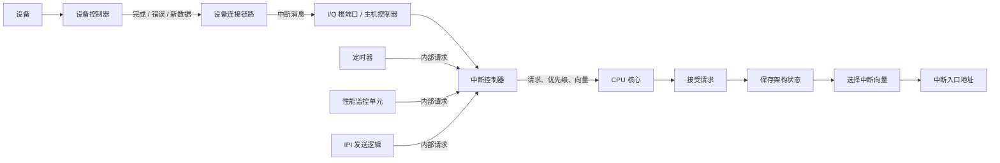

---
{"dg-publish":true,"permalink":"/CS工程体系/操作系统/中断专题-硬件逻辑/","dg-note-properties":{}}
---

# 主题八：中断专题-硬件逻辑

本篇主侧重点：中断的硬件本质。

软件侧见 [[CS工程体系/操作系统/中断专题-软件逻辑\|中断专题-软件逻辑]]。

硬件只处理事件、请求、优先级、目标核心、向量和入口地址。

硬件不感知操作系统、进程、线程、驱动或调度器。

## 中断的硬件对象

- **中断源**：产生请求的硬件单元，例如设备控制器、定时器、性能监控单元或另一个 CPU 核心的 IPI 发送逻辑。
- **中断请求**：中断源发出的电平、边沿或消息。
- **中断控制器**：接收、锁存、屏蔽、排序和路由请求的硬件。
- **中断向量**：标识某类入口的编号，或架构定义的入口信息。
- **中断入口地址**：CPU 根据向量得到的控制流目标地址。

## 硬件主图



图中只表示硬件路径。
入口地址之后可能存在指令，但本篇不讨论这些指令属于哪种软件。

中断控制器可以集成在 CPU 或 SoC 内。
x86 常见 APIC 结构，ARM 常见 GIC 结构。
不同架构的名称和寄存器不同，但基本职责相近。

## 一条外部硬件中断路径

```text
硬件事件发生
  → 中断源记录或锁存事件状态
  → 中断源产生电平、边沿或消息
  → 中断控制器接收并记录请求
  → 中断控制器检查屏蔽和优先级
  → 中断控制器选择目标 CPU 核心
  → CPU 在可接收的边界接受请求
  → CPU 保存架构状态
  → CPU 根据向量得到入口地址
  → CPU 跳转到入口地址
```

这条路径中：

- 中断源产生请求；
- 连接链路传输消息；
- 中断控制器管理请求；
- CPU 保存状态并改变控制流。

中断控制器不执行入口地址中的指令。
设备连接链路也不决定请求的优先级。

## 中断请求从哪里来

### 设备控制器

设备控制器检测到工作完成、错误或新数据时，产生中断请求。
请求可以通过独立的中断线传输，也可以通过消息传输。

设备控制器不是直接调用 CPU 接口。
它改变中断线的电气状态，或在设备链路上发送规定格式的消息。

### 定时器

定时器计数达到设定值时，产生内部中断请求。
定时器可以位于 CPU 内部或 SoC 内部。

### 性能监控单元

性能监控单元计数达到阈值时，产生内部中断请求。

### IPI 发送逻辑

一个 CPU 核心向另一个核心发送 IPI 消息。
中断控制器根据消息中的目标信息，把请求送到目标核心。

## 中断请求的传输方式

### 中断线

```text
中断源
  → 电平或边沿信号
  → 中断控制器
```

电平请求在信号保持有效时持续表示待处理状态。
边沿请求在信号发生指定变化时产生一次请求。
具体电气实现由平台定义。

### PCIe MSI / MSI-X

```text
设备控制器
  → MSI / MSI-X 写消息
  → PCIe 设备连接链路
  → I/O 根端口
  → 中断控制器
```

MSI / MSI-X 使用消息表达中断请求。
设备控制器发出消息，PCIe 链路负责传输消息。

### USB 传输完成事件

```text
USB 设备
  → USB 传输
  → USB 主机控制器
  → 主机控制器检测传输完成
  → 主机控制器产生中断请求
  → 中断控制器
```

USB 设备通常不直接向 CPU 发送中断。
主机控制器根据 USB 总线上的传输结果产生系统级请求。

## 中断控制器做什么

中断控制器可以执行以下硬件动作：

1. 接收并锁存请求。
2. 屏蔽指定请求。
3. 记录请求是否处于等待状态。
4. 比较多个请求的优先级。
5. 选择目标 CPU 核心。
6. 为请求提供或传递中断向量。
7. 向目标核心发出中断通知。

这些动作使用中断控制器内部状态和架构定义的寄存器。
中断控制器只管理请求，不保存 CPU 的程序计数器和通用寄存器。

## CPU 接收中断做什么

CPU 收到中断通知后，通常执行以下架构动作：

1. 检查当前状态是否允许接收该请求。
2. 在架构定义的边界暂停正常指令流。
3. 保存程序计数器和必要的状态寄存器。
4. 获取中断向量。
5. 根据向量查找或形成入口地址。
6. 跳转到入口地址。

保存哪些状态、使用哪种向量映射、是否切换特权级，都由 CPU 架构定义。
不同架构的细节不同，不能把某一种 CPU 的步骤当成所有 CPU 的固定步骤。

## 外部中断、异常和指令触发的入口

### 外部硬件中断

外部硬件中断来自当前指令流之外的硬件事件。
设备控制器、定时器和性能监控单元都可以产生这类请求。

### CPU 异常

CPU 在执行当前指令时发现错误或特殊条件，会产生异常。
除零、非法指令和页权限错误都属于 CPU 产生的同步事件。

异常不需要外部设备先发送中断线或消息。
异常的向量和入口过程仍由 CPU 的架构定义。

### 指令触发的架构入口

某些指令会让 CPU 按架构定义进入一个向量入口。
例如，x86 的 `int` 指令和 ARM 的 `svc` 指令都会触发这种同步控制流转移。

这类指令由当前 CPU 核心执行，不是设备控制器发出的外部请求。
本篇只说明 CPU 如何识别指令、保存状态并进入向量入口。

## 硬件边界

- 外部中断请求不是函数调用，而是硬件信号或消息；异常和指令触发的入口来自 CPU 内部事件。
- 中断控制器不是执行入口代码的处理器。
- CPU 接受请求后，硬件改变控制流；入口地址之后的行为不属于本篇。
- 设备可以产生请求，但不能自行决定 CPU 如何保存状态或选择入口地址。
- 具体的屏蔽位、优先级、向量格式和状态保存规则由 CPU 与平台架构定义。

## 硬件场景

- 网卡控制器完成一次接收后，通过 MSI-X 消息报告完成事件。
- 定时器达到计数值后，向中断控制器产生内部请求。
- 性能监控单元达到阈值后，产生内部请求。
- 一个核心发送 IPI 后，目标核心收到内部中断请求。
- CPU 执行 `int` 或 `svc` 指令后，按向量进入架构定义的入口地址。
