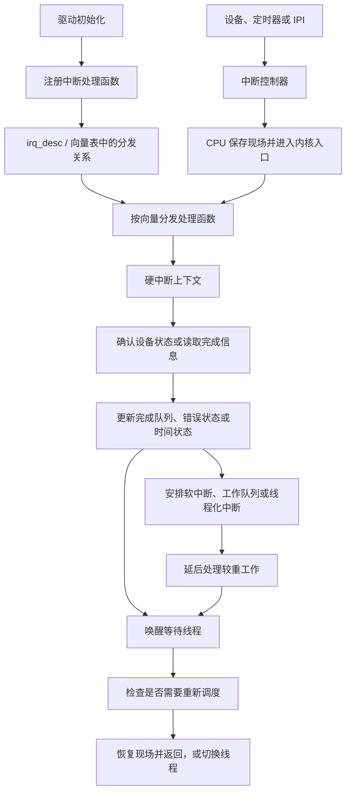

---
{"dg-publish":true,"permalink":"/CS工程体系/操作系统/中断专题-软件逻辑/","dg-note-properties":{}}
---

# 主题八：中断专题-软件逻辑

本篇主侧重点：内核如何使用硬件中断入口处理设备和 CPU 事件。

中断源、控制器、向量和 CPU 入口的硬件行为见 [[CS工程体系/操作系统/中断专题-硬件逻辑\|中断专题-硬件逻辑]]。

## 软件结构图



图中的中断入口由硬件和架构规定。
中断注册、状态确认、队列更新、延后处理和唤醒线程属于内核代码。

## 内核看到的中断路径

```text
硬件产生中断请求
  → CPU 根据向量进入内核入口
  → 内核保存或读取必要现场
  → 根据向量找到设备或事件处理路径
  → 读取设备状态并确认或清除事件
  → 更新内核队列和状态
  → 唤醒等待者或安排延后处理
  → 恢复现场并返回，或重新调度
```

中断入口地址由硬件架构定义。
入口中的寄存器保存、设备确认和后续调度属于内核软件。

## 设备中断处理

内核通常需要完成以下动作：

1. 判断中断来源和设备状态；
2. 确认或清除设备控制器中的中断状态；
3. 读取完成队列或错误信息；
4. 回收 DMA 描述符；
5. 更新文件、网络或设备队列；
6. 唤醒等待 I/O 的线程；
7. 把较重的工作延后处理。

中断处理逻辑不只访问设备控制器，也会修改内核维护的队列、引用计数和等待状态。

硬中断上下文必须保持短小。
驱动通常只确认事件、记录完成项和安排延后处理。
较重的协议栈、文件系统或回调逻辑在后续内核上下文中执行。

## 定时器和调度

定时器中断可以更新时间、减少当前线程的时间片，并触发调度检查。
是否立即切换线程取决于内核调度策略和当前上下文。

## IPI 和跨核心协作

内核使用 IPI 通知其他核心执行特定动作，例如：

- TLB shootdown；
- 重新调度；
- 更新每核心状态；
- 停止或启动某个核心。

IPI 的传输由硬件完成，目标动作由内核定义。

## 软件中断和延后处理

系统调用、异常和设备中断都可能进入内核入口，但它们的来源和处理语义不同。
设备中断中的最小工作可以触发延后处理，以减少长时间占用中断上下文。
具体的软中断、工作队列和线程化中断属于内核实现专题。

## 业务场景

网络设备频繁产生中断时，内核会使用批处理、中断合并或轮询。
文件 I/O 完成时，内核通过中断路径更新状态并唤醒等待线程。
