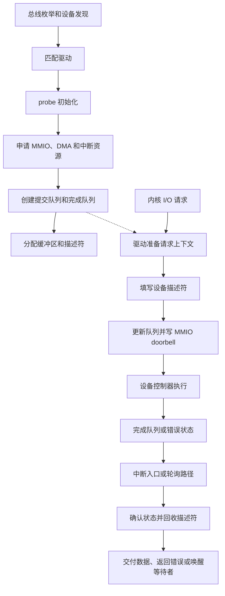

---
{"dg-publish":true,"permalink":"/CS工程体系/操作系统/具体设备专题-软件逻辑/","dg-note-properties":{}}
---

# 主题十：具体设备专题-软件逻辑

本篇主侧重点：驱动如何把具体设备接入内核的统一 I/O 模型。

设备控制器、队列、DMA 和链路见 [[CS工程体系/操作系统/具体设备专题-硬件逻辑\|具体设备专题-硬件逻辑]]。

## 软件结构图



图中的 `probe`、资源申请、描述符准备、完成回收和错误转换都是驱动代码行为。
设备控制器只执行驱动已经提交的队列和描述符。

## 驱动生命周期

```text
发现设备
  → 读取能力和配置空间
  → 映射 MMIO 寄存器
  → 分配队列、缓冲区和描述符
  → 注册中断或轮询路径
  → 提交请求
  → 处理完成和错误
  → 停止设备并释放资源
```

## 各类设备的软件状态

- **NVMe**：提交队列、完成队列、请求上下文和持久化状态；
- **网卡**：接收 / 发送环、报文缓冲区、队列到核心的映射；
- **GPU**：命令队列、设备内存、同步对象和异步完成状态；
- **USB**：设备枚举、端点状态、传输请求和主机控制器队列；
- **虚拟化和 IOMMU**：虚拟设备状态、I/O 页表和 DMA 隔离。

## 统一软件检查问题

1. 驱动初始化哪些寄存器、队列和能力？
2. 内核和设备分别拥有哪一段缓冲区？
3. 描述符从准备到回收经过哪些状态？
4. 完成事件由中断、轮询还是两者共同报告？
5. 设备错误如何转换成内核可见的错误？
6. 等待 I/O 的线程何时阻塞，何时被唤醒？
