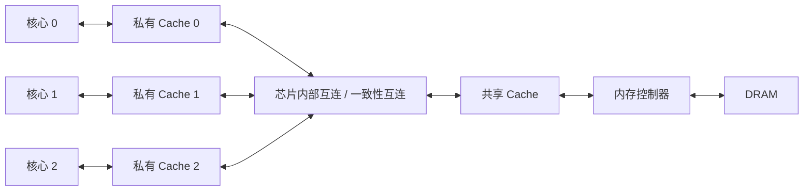

---
{"dg-publish":true,"permalink":"/CS工程体系/操作系统/多核处理器-硬件逻辑/","dg-note-properties":{}}
---

# 主题九：多核处理器-硬件逻辑

本篇主侧重点：多核心、Cache 一致性、原子指令和内存序。

软件侧见 [[CS工程体系/操作系统/多核处理器-软件逻辑\|多核处理器-软件逻辑]]。

## 硬件主图



每个核心都有自己的寄存器和私有 Cache。
多个核心也可以共享更低层 Cache。
多个核心访问同一 Cache line 时，一致性互连跟踪副本状态和写入所有权。

## 关键数据路径：两个核心修改共享数据

```text
核心 0 执行原子读改写
  → 请求 Cache line 所有权
  → 在失效型一致性协议中使其他副本失效
  → 核心 0 修改并保持为已修改状态
  → 核心 1 再次读取时获取最新 Cache line
```

读—改—写原子指令把读、改、写组合成一个操作。
其他核心不能观察到其中的中间状态。
内存序约束编译器和硬件对内存访问的重排。
内存序也约束其他核心可以观察到的访问顺序。
缓存一致性保证同一地址的副本遵守一致的值。
缓存一致性不建立完整的线程同步顺序。

## 业务场景

- 多线程队列让不同线程频繁写入同一 Cache line 时，会出现伪共享。
- 伪共享会增加一致性流量。
- 数据库缓冲池、连接池和计数器会受到锁竞争、原子操作和 Cache miss 的影响。
