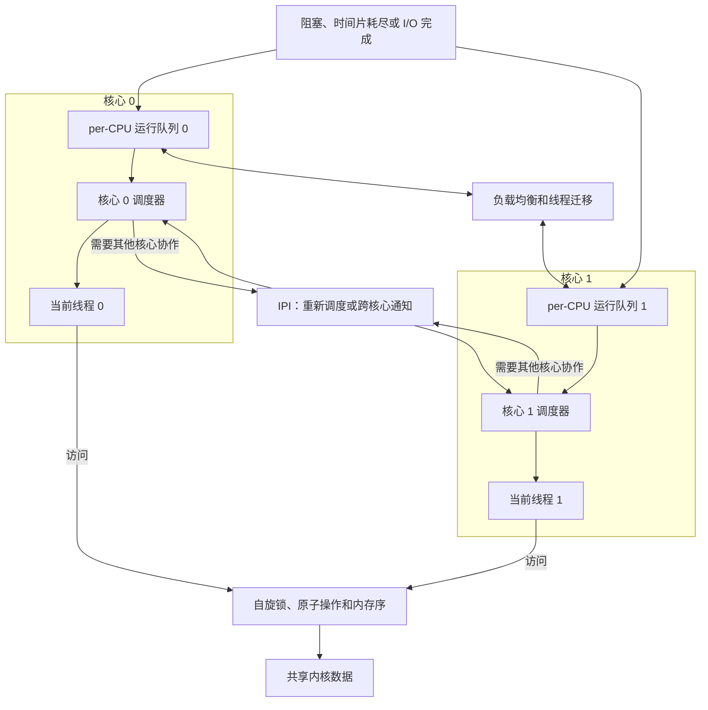

---
{"dg-publish":true,"permalink":"/CS工程体系/操作系统/多核处理器-软件逻辑/","dg-note-properties":{}}
---

# 主题九：多核处理器-软件逻辑

本篇主侧重点：内核如何在多个核心上调度线程，并保护共享状态。

Cache 一致性、原子指令和内存序见 [[CS工程体系/操作系统/多核处理器-硬件逻辑\|多核处理器-硬件逻辑]]。

## 软件结构图



图中的运行队列、调度器、锁、IPI 和线程迁移都是内核代码行为。
CPU 核心只执行内核安排的线程和同步指令。

## 调度和亲和性

内核维护每核心运行队列或共享运行队列。
调度器根据优先级、负载、亲和性和局部性选择目标核心。
线程迁移会改变 Cache 局部性，也可能触发地址空间和 TLB 相关开销。

调度器在目标核心上更新运行队列，并在需要时发送 IPI 请求目标核心重新调度。

```text
线程进入就绪队列
  → 调度器选择目标核心
  → 核心恢复线程上下文
  → 线程运行或阻塞
  → 时间片耗尽、事件到达或线程主动让出
  → 调度器选择下一个线程
```

## 共享数据同步

内核使用锁、原子变量、读写同步和无锁结构保护共享状态。
这些原语依赖硬件原子性、Cache 一致性和内存序。
Cache 一致性本身不定义内核数据结构的访问规则。

锁竞争时，线程可以自旋，也可以进入等待队列并让出核心。
锁释放后，内核按同步原语的规则唤醒等待线程。

## 每核心数据

每核心数据可以减少共享写入和锁竞争。
但跨核心读取、线程迁移和中断处理仍然需要明确的可见性规则。

## 业务场景

数据库缓冲池、连接池和网络队列会受到锁竞争、线程迁移、伪共享和 Cache miss 的共同影响。
合理的 CPU 亲和性可以减少 Cache 局部性损失。
