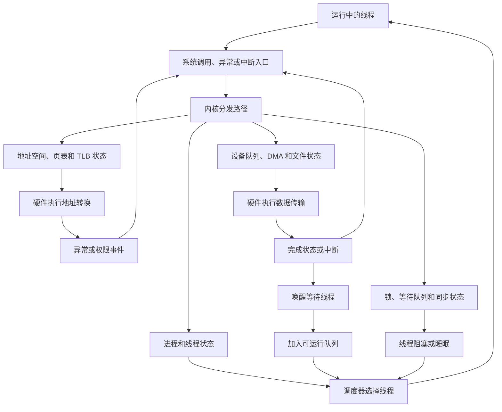

---
{"dg-publish":true,"permalink":"/CS工程体系/操作系统/操作系统学习主线-软件逻辑/","dg-note-properties":{}}
---

# 操作系统学习主线-软件逻辑

> **从硬件提供的机制出发，学习内核如何组织状态、配置硬件和处理事件。**

这条主线关注操作系统的软件行为。
它和 [[CS工程体系/操作系统/操作系统学习主线-硬件逻辑\|操作系统学习主线-硬件逻辑]] 使用同一组硬件事实，但观察角度不同。

- 硬件逻辑问：硬件如何转换地址、传输数据和改变控制流？
- 软件逻辑问：内核维护什么状态，怎样使用这些硬件机制？
- 业务场景问：这些机制怎样影响延迟、吞吐和并发？

## 软件和硬件的共同边界

硬件和内核通过少量稳定机制连接：

- 指令集和特权级；
- 页表、TLB 和地址空间根；
- MMIO 寄存器和设备队列；
- DMA 地址、缓冲区和描述符；
- 中断向量、异常入口和 IPI；
- 原子指令、缓存一致性和内存序。

硬件专题解释这些机制怎样工作。
软件专题解释内核怎样配置、维护和使用这些机制。
边界的完整说明见 [[CS工程体系/操作系统/软件-硬件边界专题-软件逻辑\|软件-硬件边界专题-软件逻辑]]。

## 软件主线的共同路径

```text
线程运行
  → 执行普通指令或发起系统调用
  → CPU 进入内核入口，或内核访问硬件寄存器
  → 内核修改页表、设备队列或等待队列
  → 硬件执行地址转换、数据传输或产生事件
  → 内核处理异常、中断或完成状态
  → 唤醒等待者并重新调度
  → 线程继续运行
```

这条路径是学习索引。
每个专题只展开自己负责的状态和动作。

每个主题分别提供硬件逻辑文件和软件逻辑文件。
两份文件通过边界说明和交叉链接保持连接。

## 软件主线图



这张图描述内核代码的共同闭环：进入内核、读取或修改状态、配置硬件、等待事件、唤醒线程和重新调度。
每个专题只展开其中一段闭环。

## 推荐顺序

| 顺序 | 主题 | 软件主线要回答的问题 |
| --- | --- | --- |
| 1 | [[CS工程体系/操作系统/硬件结构-软件逻辑\|硬件结构-软件逻辑]] | 内核能看到哪些硬件资源，使用哪些控制接口？ |
| 2 | [[CS工程体系/操作系统/CPU 核心如何执行指令-软件逻辑\|CPU 核心如何执行指令-软件逻辑]] | 线程上下文怎样被装入核心，怎样保存和恢复？ |
| 3 | [[CS工程体系/操作系统/Cache 和内存层次-软件逻辑\|Cache 和内存层次-软件逻辑]] | 内核怎样使用原子指令、锁和内存序组织共享数据？ |
| 4 | [[CS工程体系/操作系统/页表 和 页-软件逻辑\|页表 和 页-软件逻辑]] | 内核怎样建立进程地址空间，怎样处理缺页？ |
| 5 | [[CS工程体系/操作系统/页表更新-软件逻辑\|页表更新-软件逻辑]] | 内核怎样安全修改映射并协调多个核心的 TLB？ |
| 6 | [[CS工程体系/操作系统/fork-软件逻辑\|fork-软件逻辑]] | 内核怎样创建进程并通过写时复制共享页面？ |
| 7 | [[CS工程体系/操作系统/I-O、MMIO、DMA 和中断-软件逻辑\|I-O、MMIO、DMA 和中断-软件逻辑]] | 驱动怎样配置设备、提交 DMA，并接收完成事件？ |
| 8 | [[CS工程体系/操作系统/中断专题-软件逻辑\|中断专题-软件逻辑]] | 硬件怎样把请求送到 CPU，内核入口依赖什么硬件事实？ |
| 9 | [[CS工程体系/操作系统/多核处理器-软件逻辑\|多核处理器-软件逻辑]] | 内核怎样在多个核心上调度线程并保护共享数据？ |
| 10 | [[CS工程体系/操作系统/io多路复用-软件逻辑\|io多路复用-软件逻辑]] | 内核怎样等待多个 I/O 对象并返回就绪状态？ |
| 11 | [[CS工程体系/操作系统/具体设备专题-软件逻辑\|具体设备专题-软件逻辑]] | 不同设备的驱动、队列、DMA 和完成处理有什么差异？ |

## 当前已有专题的侧重点

同一个主题可以同时出现在硬件主线和软件主线。
两条主线引用同一主题时，侧重点不同：

| 主题 | 硬件逻辑侧重点 | 软件逻辑侧重点 |
| --- | --- | --- |
| `fork` | 页表权限、缺页异常、TLB 和物理页访问 | 进程创建、COW 映射、异常处理和进程状态 |
| 页表更新 | TLB 项失效和跨核心通知 | 页表修改顺序、shootdown 协议和安全回收 |
| 中断 | 中断源、控制器、向量和 CPU 控制流 | 入口代码、设备状态确认、事件分发和唤醒 |
| I/O | MMIO、DMA、设备链路和中断 | 驱动状态、队列、缓冲区和等待者 |
| 多核 | 一致性、原子指令和内存序 | 锁、调度、并发数据结构和内核同步 |

## 后续需要补充的内核专题

当前配对专题可以建立基础路径。
后续可继续补充以下独立软件专题：

- 进程、线程和地址空间模型；
- 系统调用、特权级和异常入口；
- 调度器和上下文切换；
- 内核中断处理和延后处理；
- 文件系统和页缓存；
- 网络栈和套接字；
- 内核同步原语和等待队列。

`中断专题-硬件逻辑` 只解释硬件路径。内核入口、设备状态确认和延后处理见 [[CS工程体系/操作系统/中断专题-软件逻辑\|中断专题-软件逻辑]]。

## 每个软件专题的固定格式

```text
一张软件状态图
+ 一条内核关键路径
+ 一个业务场景例子
```

业务例子继续放在各专题末尾，用来解释软件决策带来的性能和行为影响。
