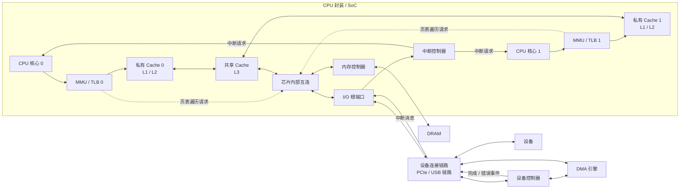

---
{"dg-publish":true,"permalink":"/CS工程体系/操作系统/硬件结构-硬件逻辑/","dg-note-properties":{}}
---

# 主题一：现代计算机硬件总览-硬件逻辑

本篇主侧重点：硬件逻辑。

软件侧见 [[CS工程体系/操作系统/硬件结构-软件逻辑\|硬件结构-软件逻辑]]。

## 物理边界

- **CPU 封装 / SoC 内**：CPU 核心、Cache、MMU / TLB、芯片内部互连、内存控制器、I/O 根端口。
- **CPU 封装外**：DRAM 和 I/O 设备。在这类系统中，设备通过设备控制器、DMA 引擎和设备链路与系统相连。

## 硬件主图



图中画出两个示意核心。
每个核心都有一个地址转换单元和一个私有 Cache。
因此，图中出现 `MMU / TLB 0` 和 `MMU / TLB 1`。
这两个单元分别属于核心 0 和核心 1。
系统不固定只有两套单元。
进程也不各自拥有一套单元。
部分处理器在不同层级共享 TLB。
TLB 缓存地址转换结果。
MMU 执行地址转换和权限检查。

中断硬件路径见 [[CS工程体系/操作系统/中断专题-硬件逻辑\|中断专题-硬件逻辑]]。

## 关键数据路径

### 核心访问内存

```text
CPU 核心
  → MMU / TLB
  → 私有 Cache
  → 共享 Cache
  → 芯片内部互连
  → 内存控制器
  → DRAM
```

地址转换发生在访问路径前段。
核心先产生虚拟地址。
TLB 命中时，处理器直接得到物理页框。
TLB 未命中时，处理器执行页表遍历。

页表遍历会产生内存读取请求。
这些请求经过芯片内部互连和内存系统。
处理器先检查 Cache 中的页表项。
Cache 未命中时，处理器再访问 DRAM。

### 设备访问内存

```text
设备
  → 设备控制器 / DMA 引擎
  → 设备连接链路
  → I/O 根端口
  → 芯片内部互连
  → 内存控制器
  → DRAM
```

设备中断路径见 [[CS工程体系/操作系统/中断专题-硬件逻辑\|中断专题-硬件逻辑]]。

## 业务场景

- 数据库关心 Cache 命中率。
- DRAM 访问的延迟高于 Cache 命中。
- 网卡使用 DMA 把收到的数据写入 DRAM。
- CPU 不必逐字节搬运这些数据。
- 多线程共享数据时，多个核心的 Cache 必须保持一致。
