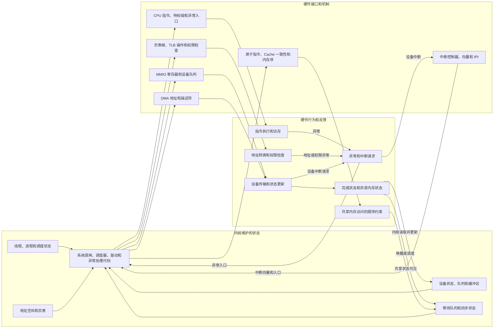

---
{"dg-publish":true,"permalink":"/CS工程体系/操作系统/硬件结构-软件逻辑/","dg-note-properties":{}}
---

# 主题一：现代计算机硬件总览-软件逻辑

本篇主侧重点：内核如何看到、配置和使用计算机硬件。

硬件结构见 [[CS工程体系/操作系统/硬件结构-硬件逻辑\|硬件结构-硬件逻辑]]。

## 软件结构图：内核状态与硬件反馈

这张图描述内核与硬件之间反复出现的关系。
它不绑定网卡、磁盘或某一种 I/O 请求。



图中的左向右路径表示内核配置或使用硬件。
图中的回流路径表示硬件结果重新进入内核状态。
硬件结果可以通过异常、中断、轮询状态或共享状态回到内核。
图中的“内核代码”表示系统调用、调度器、驱动和异常处理的执行路径。

## 内核直接维护的状态

这些对象由内核创建、修改和回收：

- 可运行线程和运行队列；
- 进程地址空间；
- 页表和物理页引用；
- 设备提交队列和完成队列；
- DMA 缓冲区所有权和描述符状态；
- 等待队列、文件状态和网络连接状态。

## 内核配置或使用的硬件接口

这些对象由硬件提供，内核按架构或设备协议使用：

- CPU 核心：运行线程，保存和恢复线程上下文；
- MMIO 寄存器：初始化设备、提交请求、读取状态；
- 页表根和 TLB 操作：切换地址空间，执行地址转换；
- DMA 引擎：读取或写入内核提供的缓冲区；
- 中断控制器和 IPI：传递中断请求，通知其他核心；
- 原子指令：执行不可分割的读改写；
- 内存序和内存屏障：约束编译器与 CPU 访问共享内存的顺序。

## 硬件提供的并发保证

Cache 一致性、原子指令和 CPU 架构内存序是底层机制。
它们为内核提供并发基础，但不包含锁、等待队列或调度策略。

内核把这些机制组合成锁、无锁结构、等待队列和调度器。

## 内核使用硬件的共同路径

```text
内核建立地址空间和线程上下文
  → 配置页表、设备寄存器和 DMA 队列
  → 线程运行或进入等待
  → 硬件执行地址转换、数据传输或产生完成通知
  → 内核处理异常、中断或完成状态
  → 更新内核状态并唤醒等待者
```

内核维护软件状态。
硬件执行架构规定的转换、检查、传输和控制流切换。

## 业务影响

内核的资源管理方式会影响：

- 线程切换延迟；
- 缺页和 TLB 失效开销；
- DMA 缓冲区的复制次数；
- 中断处理延迟；
- 锁竞争和 Cache 争用。
