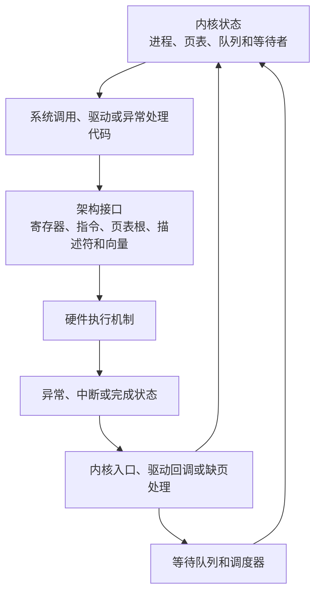

---
{"dg-publish":true,"permalink":"/CS工程体系/操作系统/软件-硬件边界专题-软件逻辑/","dg-note-properties":{}}
---

# 软件-硬件边界专题-软件逻辑

本篇主侧重点：内核如何维护状态，并通过架构接口使用硬件机制。

硬件提供的执行机制见 [[CS工程体系/操作系统/软件-硬件边界专题-硬件逻辑\|软件-硬件边界专题-硬件逻辑]]。
硬件主线见 [[CS工程体系/操作系统/操作系统学习主线-硬件逻辑\|操作系统学习主线-硬件逻辑]]。
软件主线见 [[CS工程体系/操作系统/操作系统学习主线-软件逻辑\|操作系统学习主线-软件逻辑]]。

## 软件结构图



图中的接口是软件和硬件的边界。
内核代码决定何时配置接口，以及收到硬件结果后修改哪些状态。

## 内核需要回答的四个问题

1. 哪个状态由内核维护？
2. 内核通过哪个寄存器、指令或入口使用硬件？
3. 哪个硬件事件会把控制流交给内核？
4. 内核完成哪些动作后，线程才能继续运行？

## 内核状态和硬件接口

| 硬件接口 | 内核维护的状态 | 内核动作 |
| --- | --- | --- |
| 页表和地址空间根 | 虚拟区域、权限、物理页引用 | 建立、修改和销毁地址空间 |
| TLB 失效指令 | 旧映射的使用范围 | 安排本地和远端失效 |
| MMIO 寄存器 | 设备能力、队列和错误状态 | 初始化设备、提交请求和确认状态 |
| DMA 描述符 | 缓冲区所有权和请求上下文 | 准备、提交和回收描述符 |
| 中断向量 | 设备到内核的事件映射 | 注册入口、确认事件和分发工作 |
| IPI | 目标核心和同步目的 | 请求 TLB 失效、重新调度或更新状态 |

## 例子：写时复制

```text
内核把父子进程的页面映射为只读
  → CPU 报告写权限异常
  → 内核检查地址区域和 COW 状态
  → 内核分配新页并复制数据
  → 内核更新当前进程的页表
  → 内核使旧 TLB 项失效
  → 返回并重新执行写指令
```

硬件检查权限并报告异常。
进程语义、页面复制和映射更新属于内核。

## 例子：设备完成 DMA

```text
内核准备 DMA 缓冲区和描述符
  → 设备控制器执行 DMA
  → 设备产生中断或完成状态
  → 内核入口确认设备状态
  → 驱动回收队列项
  → 内核唤醒等待 I/O 的线程
```

DMA 传输和中断路由属于硬件。
缓冲区所有权、队列状态和线程唤醒属于内核。

## 软件侧原则

- 内核策略决定硬件机制如何组合使用；
- 内核必须遵守架构规定的寄存器、指令和内存序；
- 硬件事件通过异常、中断或状态读取进入内核逻辑；
- 内核状态通过页表、寄存器、队列和描述符进入硬件。

分析一个内核路径时，先找出入口，再找出内核维护的状态，最后找出硬件接口和返回事件。
