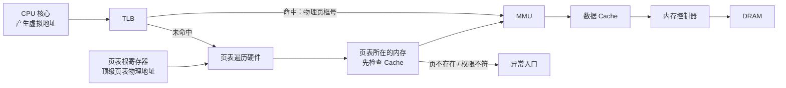

---
{"dg-publish":true,"permalink":"/CS工程体系/操作系统/页表 和 页-硬件逻辑/","dg-note-properties":{}}
---

# 主题四：虚拟内存-硬件逻辑

本篇主侧重点：虚拟地址转换、权限检查和缺页硬件。

软件侧见 [[CS工程体系/操作系统/页表 和 页-软件逻辑\|页表 和 页-软件逻辑]]。

## 两种地址

- **虚拟地址**：CPU 核心执行指令时产生的地址。
  进程看到连续且相互隔离的地址空间。
  共享内存和内核映射使用特殊映射。
- **物理地址**：系统地址译码使用的地址。
  物理地址可以指向 DRAM，也可以指向 MMIO 设备区域。

虚拟地址拆成：

```text
虚拟地址 = 虚拟页号 + 页内偏移
物理地址 = 物理页框号 + 页内偏移
```

页内偏移保持不变。
页表把虚拟页号映射到物理页框号。
常见页大小是 4 KiB。
部分系统支持更大的页。

## 相关概念

- **地址空间**：一组可以被当前执行上下文使用的虚拟地址。不同进程可以使用不同的地址空间。
- **页表根**：顶级页表的物理地址。MMU 从这个地址开始遍历页表。
- **页表层级**：页表根、下级页表和叶子页表项组成的树。
- **页表项**：记录下一级页表地址，或记录虚拟页到物理页框的映射和访问权限。
- **页表根寄存器**：处理器保存当前页表根的寄存器。切换地址空间时，内核会更新这个寄存器。
- **页表遍历**：TLB 未命中时，硬件按虚拟页号的各级索引读取页表项。
- **TLB**：处理器缓存的地址转换结果。TLB 命中时，硬件不必重新遍历页表。
- **ASID / PCID**：地址空间标签。标签可以区分不同地址空间的 TLB 项。

页表根不是完整页表。
页表根也不是页表项。
页表根只是页表树的起点。

## 硬件主图



地址转换过程：

1. 核心产生虚拟地址。
2. TLB 查找最近使用的虚拟页到物理页框的映射。
3. TLB 命中时，MMU 组合物理页框号和页内偏移。
4. TLB 未命中时，硬件按页表层级读取页表项。
5. 页表项标记为不存在时产生缺页异常；权限不符时产生保护异常或访问异常。

页表根寄存器只标识当前地址空间的页表入口。
它不保存整个页表。
页表的各级内容仍然存放在内存中。

不同架构使用不同的页表根寄存器。
例如，x86 使用 `CR3`，ARM 使用 `TTBR0` 或 `TTBR1`，RISC-V 使用 `satp`。
寄存器的具体字段由架构规定。

## 业务场景

随机访问会增加 TLB miss、页表遍历和 Cache miss 的概率。
这些事件会增加访问延迟。
数据库、内存映射文件和大内存服务会关注页大小、TLB 覆盖范围和缺页次数。
