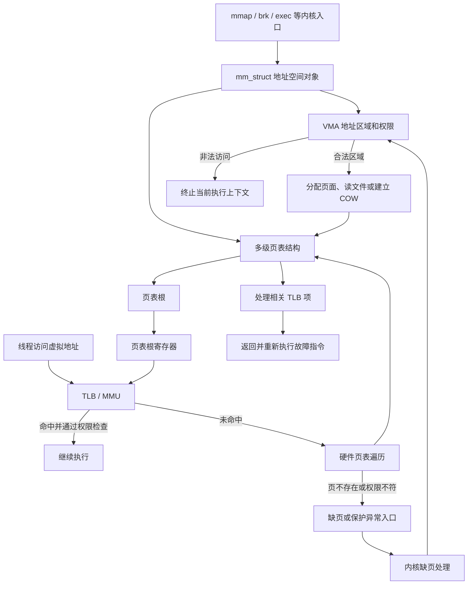

---
{"dg-publish":true,"permalink":"/CS工程体系/操作系统/页表 和 页-软件逻辑/","dg-note-properties":{}}
---

# 主题四：虚拟内存-软件逻辑

本篇主侧重点：内核如何建立地址空间、维护页表并处理缺页。

地址转换、TLB、MMU 和页表遍历见 [[CS工程体系/操作系统/页表 和 页-硬件逻辑\|页表 和 页-硬件逻辑]]。

## 软件结构图



图中的 `mm_struct`、VMA、页表和页表根由内核维护。
MMU 和 TLB 负责每次访问的转换与权限检查。

## 地址空间状态

内核为每个进程维护地址空间描述、页表根和页表页。
页表根标识顶级页表。
页表项记录虚拟页与物理页框的关系，以及用户、读写、执行等权限。

## 相关概念

- **地址空间描述**：内核保存的地址范围、映射关系和权限信息。
- **页表根**：内核保存的顶级页表物理地址。切换地址空间时，内核把它写入处理器的页表根寄存器。
- **页表页**：存放页表项的物理页。多级页表会包含多个页表页。
- **页表项**：描述下一级页表，或描述一个虚拟页对应的物理页框。
- **页表根寄存器**：处理器保存当前地址空间入口的寄存器。
- **TLB 项**：处理器缓存的虚拟页到物理页框的转换结果。
- **ASID / PCID**：内核和处理器用来区分地址空间的标签。

内核维护页表内容。
MMU 使用页表根完成地址转换。
TLB 缓存近期转换结果。
页表根变化后，内核必须按架构规则处理旧 TLB 项。

页可以来自：

- 匿名内存；
- 文件映射；
- 共享内存；
- 设备映射；
- 内核保留区域。

## 建立映射路径

```text
内核创建或扩展地址空间
  → 分配页表层级
  → 分配物理页或建立文件映射
  → 写入页表项和权限
  → 按架构规则处理 TLB
  → 线程访问虚拟地址
```

内核决定哪些地址存在、映射到哪里，以及允许哪些访问。
硬件负责每次访问的转换和权限检查。

`mmap` 等系统调用修改地址空间描述。
缺页异常路径根据 VMA 决定是否建立实际页映射。

## 缺页处理路径

```text
线程访问未映射或权限不满足的地址
  → CPU 产生缺页或保护异常
  → 内核读取异常地址和访问类型
  → 查找地址空间区域
  → 分配页面、从文件装入或建立写时复制映射
  → 写入页表项
  → 使相关 TLB 项失效
  → 返回并重新执行故障指令
```

如果访问不属于合法区域，内核会终止这次访问对应的执行上下文。

## 业务场景

大内存服务会受到页表层级、缺页次数、页大小和 TLB 覆盖范围影响。
内存映射文件同时连接文件系统、页缓存和地址空间管理。
