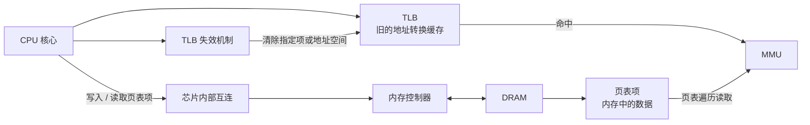

---
{"dg-publish":true,"permalink":"/CS工程体系/操作系统/页表更新-硬件逻辑/","dg-note-properties":{}}
---

# 主题五：页表更新-硬件逻辑

本篇主侧重点：页表项、TLB 项和硬件失效机制。

软件侧见 [[CS工程体系/操作系统/页表更新-软件逻辑\|页表更新-软件逻辑]]。

页表更新涉及两个对象：

- **页表项**：存放在内存中的数据。操作系统写入页表项。
- **TLB 项**：处理器内部缓存的地址转换。TLB 项会保存旧映射或旧权限。

TLB 通常属于某个 CPU 核心。
TLB 不属于某个进程。
线程切换到不同地址空间时，硬件使用地址空间标签或失效操作区分转换。
地址空间标签包括 ASID 和 PCID。
多个核心可以各自保留同一地址空间的 TLB 项。

操作系统写入新的页表项时，不会自动修改所有核心上的 TLB。
更新页表后，必须按架构规则让旧 TLB 项失效。
完成失效后，系统才可以使用或回收对应的物理页。

## 硬件主图

页表项在内存中。
TLB 项在核心内部。
页表内容改变后，旧 TLB 项仍会让核心使用旧的物理地址或旧权限。
对应 TLB 项失效后，核心才会使用新页表项。

## 硬件失效动作

硬件提供以下机制：

- 清除本地 TLB 中的单个地址项；
- 清除某个地址空间的 TLB 项；
- 使用地址空间标签区分不同地址空间；
- 通过 IPI 把失效请求送到其他核心；
- 按架构规定的内存顺序执行页表读取和失效操作。

x86 常见 `INVLPG`。
ARM 常见 TLBI 指令。
其他平台使用不同的失效指令和同步规则。

## 业务场景

- 进程频繁执行 `mmap` / `munmap` 时，页表写入、TLB 失效和跨核心 IPI 会增加开销。
- `fork` 的写时复制依赖正确的页表权限。
- 第一次写入时，旧权限清除后，处理器才会触发缺页处理。
- 解除映射后，系统必须先清除所有旧 TLB 项。
- 系统清除旧 TLB 项后，才可以回收物理页。
- 错误的顺序会造成错误写入或安全问题。
