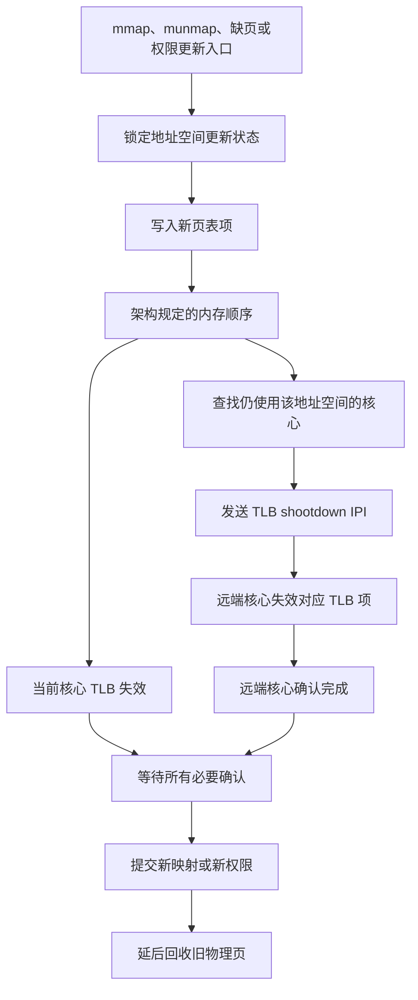

---
{"dg-publish":true,"permalink":"/CS工程体系/操作系统/页表更新-软件逻辑/","dg-note-properties":{}}
---

# 主题五：页表更新-软件逻辑

本篇主侧重点：内核如何修改页表，并协调多个核心停止使用旧映射。

TLB 的缓存和失效机制见 [[CS工程体系/操作系统/页表更新-硬件逻辑\|页表更新-硬件逻辑]]。

## 软件结构图



图中的 `LOCK`、核心集合、IPI 确认和延后回收都是内核代码行为。
硬件只提供页表读取、TLB 失效指令和 IPI 传递机制。

## 更新协议

```text
内核准备新页表项
  → 按架构要求写入页表并保证可见
  → 使本地 TLB 中的旧项失效
  → 找到仍使用该地址空间的其他核心
  → 通过 IPI 请求远端核心失效
  → 等待必要的确认
  → 继续使用新映射或回收旧物理页
```

内核不能在远端核心仍然持有旧 TLB 项时复用旧物理页。

这个跨核心过程通常称为 **TLB shootdown**。
地址空间标签可以减少失效范围，但不能跳过正确性处理。

## 常见触发场景

- `mmap`、`munmap` 或修改内存权限；
- `fork` 后建立写时复制映射；
- 缺页处理后安装新页表项；
- 页面迁移、换出或回收物理页；
- 内核收紧可写或可执行权限。

## 安全回收

解除映射后，内核不能立即复用旧物理页。
必须先确认所有可能使用该地址空间的核心已经失效旧 TLB 项。
完成确认后，旧物理页才可以回收或重新分配。

## 业务场景

频繁修改映射会产生页表写入、TLB 失效和跨核心 IPI 开销。
大规模多线程进程更容易放大 TLB shootdown 的延迟。
